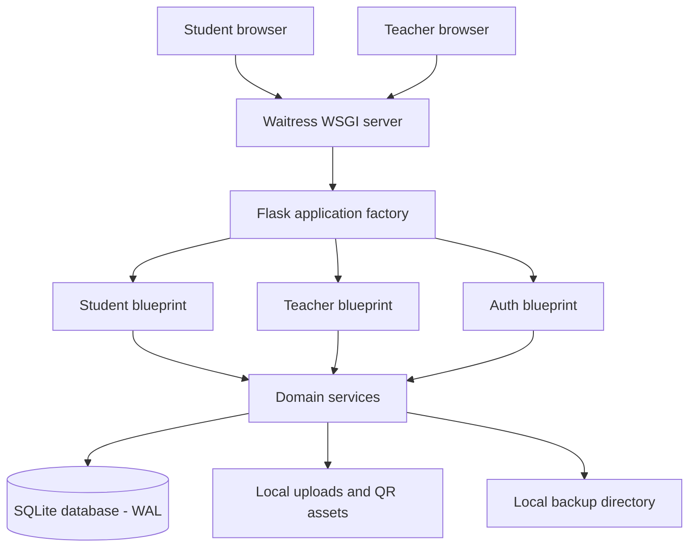

# Kitaab Bank — Current Architecture

This document describes the implementation currently present in the repository. Product ideas and historical decisions remain in the PRD and progress log.

## 1. System overview

Kitaab Bank is a single-host Flask application intended for a school computer running on the school's local Wi-Fi. Student and teacher devices use a browser; application state is stored locally in SQLite and on the host disk.

## 2. Runtime stack

| Layer | Current implementation |
|---|---|
| Web framework | Flask application factory in `app/__init__.py` |
| WSGI server | Waitress via `run_server.py` |
| Development server | Flask development launcher via `run_dev.py` |
| Database | SQLite using Python's `sqlite3`, WAL mode, foreign keys, and busy timeout |
| Templates | Jinja2 server-rendered HTML |
| UI assets | Locally vendored Bootstrap and Font Awesome plus project CSS |
| Browser behavior | Vanilla JavaScript: theme switching, table behavior, and QR scanning |
| QR generation | Python `qrcode` and Pillow |
| Localization | English, Urdu, and Sindhi translation dictionaries and RTL styles |
| Tests | Python tests under `tests/` and root-level test scripts |

There is no API blueprint in the current source tree. The registered blueprints are Student, Teacher, and Auth.

## 3. Application modules

### Student blueprint

The public student experience includes the home page, approved-book catalogue, book details, donation submission, request submission, request tracking, QR/manual code scanning, and static QR image generation. Students do not create accounts. Tracking pages mask identifying information.

### Teacher blueprint

The authenticated Teacher Desk includes dashboard metrics, donation review, request approval/rejection, reservations, physical handover confirmation and receipts, catalogue inventory management, QR label printing, reports/CSV exports, activity logs, school settings, password changes, database backups, and Exhibition Demo Mode.

All teacher routes are protected by a blueprint-level `before_request` guard. The initial-password gate limits bootstrap-password sessions to the Security settings until a new password is saved.

### Auth blueprint

Teacher login establishes a session, validates post-login redirect targets, records login activity, and applies failed-login rate limiting. Logout clears the session.

## 4. Domain services

The current `app/services/` directory contains the business logic for books, donations, requests, handovers, analytics, activity logs, QR codes, backups, maintenance/restore coordination, settings, rate limiting, and translation.

Database writes that require multiple related changes should use `db_transaction()`. It acquires the SQLite write lock before the operation and rolls back on failure; lock retries apply only to acquiring the transaction, not to replaying the business operation.

## 5. Persistence and file layout

| Data | Location |
|---|---|
| Main SQLite database | `DATABASE_PATH` (default: project-root `kitaab_bank.db`) |
| Book photos | `app/static/uploads/books/` by default |
| QR uploads/print assets | `app/static/uploads/qr/` by default |
| Database snapshots | `BACKUP_FOLDER` (default: `backups/`) |
| Recovery markers | `.restore_in_progress` and `.maintenance_lock` beside the configured database |

Uploaded user images and local database/backups are excluded from Git by `.gitignore`. Book cover illustrations and static vendor libraries are source-controlled.

## 6. Restore safety

The backup service validates target backup integrity, SQLite schema and SHA-256 when catalogued. Restoration uses a pre-restore snapshot, a maintenance gate, connection draining, and a recovery marker. On application startup, the recovery marker is checked before the live database is opened.

The general restore command is provided by `scripts/restore_backup.py`. Teacher Settings currently exposes backup creation, download, and deletion; it does not expose a general-purpose restore button. Exiting Exhibition Demo Mode restores its recorded pre-demo snapshot.

## 7. Offline and network model

The application serves its local CSS, JavaScript, fonts, and images from the host machine and does not require runtime CDN access. For school Wi-Fi access, Waitress listens on the configured LAN interface (the bundled launcher uses port 5000). Mobile camera scanning requires a secure browser context; manual code entry remains the fallback on plain HTTP LAN addresses.

## 8. Important implementation boundaries

- This is a single-school, local-server application; it is not a cloud-hosted multi-tenant service.
- Student book exchange inventory tracks individual textbook records, not the proposed bulk government stock ledger. That separate school-distribution module is not part of the current implementation.
- SQLite and backup files remain on the host machine. Protect the computer, its backups, and the school LAN accordingly.
