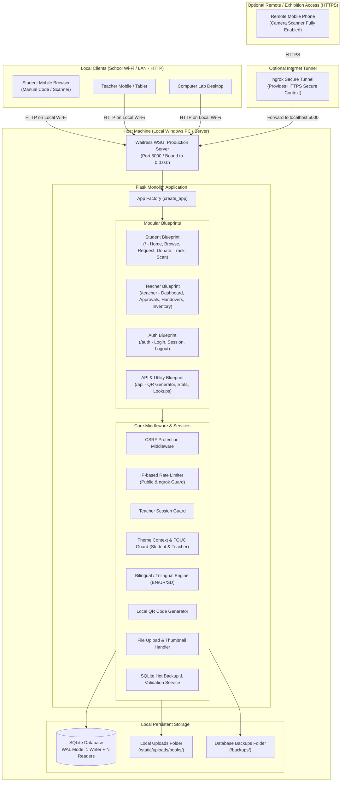

# System Architecture & Technical Design
## Project: Kitaab Bank – Smart School Book Exchange (کتاب بینک)

---

## 1. Architectural Overview & System Topography

Kitaab Bank is architected as an **offline-first, lightweight local web application** designed to run on a single host computer (e.g., a school laptop or lab desktop) while serving multiple client devices (phones, tablets, PCs) concurrently over the school's local area network (LAN/Wi-Fi).



---

## 2. Technology Stack & Component Justifications

| Layer | Selected Technology | Technical Justification |
|---|---|---|
| **Backend Framework** | **Python Flask 3.x** | Minimalist, robust, low memory footprint, zero hidden magic. Ideal for school-grade reliability without unnecessary ORM bloat. |
| **WSGI Server** | **Waitress** | Production-quality, multi-threaded pure-Python WSGI server that runs natively on Windows without requiring complex Unix daemons. Binds to `0.0.0.0:5000`. |
| **Database** | **SQLite 3 (WAL mode)** | Single-file zero-configuration local database. Configured with Write-Ahead Logging (`WAL`), `busy_timeout = 5000ms`, and short atomic write transactions (`BEGIN IMMEDIATE`) to safely support concurrent readers and serialized writers across local devices. |
| **Template Engine** | **Jinja2 (Flask Built-in)** | Server-side rendering with automatic HTML contextual escaping (mitigates XSS), shared template macros, and bilingual translation helpers. |
| **Styling & Design System** | **Modern CSS3 (Custom Properties)** | Pure CSS tokens for Light, Dark, and System Default themes. Zero external CSS frameworks (no Tailwind or Bootstrap CDN) ensures 100% offline uptime and ultra-fast rendering. |
| **Client-Side Scripting** | **Vanilla ES6+ JavaScript** | Self-contained, lightweight JS for theme switching, instant client-side search filtering, modal controls, and camera QR scanning. Zero npm build step. |
| **QR Generation** | **Python `qrcode` + `Pillow`** | High-performance local SVG and PNG QR code generation directly on the server. Zero external QR APIs. |
| **QR Scanning** | **Dual-Mode Scanner (HTML5 Video + Manual Fallback)** | Vendored lightweight JavaScript scanner running client-side in the browser. Handles mobile camera Secure Context restrictions with immediate manual code entry. |
| **Image Handling** | **Pillow (PIL)** | Automatic image resizing (max 800px width), compression, and format standardization (JPEG/WebP) to conserve disk space and strip EXIF data. |
| **External Exposure (Optional)** | **ngrok** | Provides a secure temporary HTTPS tunnel for live mobile testing or remote exhibition judging over cellular data. Completely optional; application works fully offline without it. |

---

## 3. Directory & Folder Structure

```
Kitab Dost/
│
├── run_server.py                 # Waitress WSGI production launcher (LAN binding & IP banner)
├── run_dev.py                    # Flask development server (auto-reloader)
├── run_tunnel.py                 # Optional ngrok runner helper (provides HTTPS for camera)
├── config.py                     # Configuration settings (Dev, Prod, Test, Rate Limits)
├── requirements.txt              # Pinned Python dependencies
│
├── app/                          # Core Application Package
│   ├── __init__.py               # Flask Application Factory (create_app)
│   ├── database.py               # SQLite connection helper, WAL setup, transaction manager
│   ├── schema.sql                # Complete DDL schema script
│   ├── seed_data.py              # Sample books, donations, and demo teacher account
│   │
│   ├── blueprints/               # Functional Blueprints
│   │   ├── student/              # Student facing routes
│   │   │   ├── __init__.py
│   │   │   └── routes.py         # /, /catalogue, /book/<code_or_id>, /donate, /request, /track, /scan
│   │   ├── teacher/              # Teacher protected dashboard routes
│   │   │   ├── __init__.py
│   │   │   └── routes.py         # /teacher/dashboard, /donations, /requests, /handovers, /inventory, /reports, /settings
│   │   ├── auth/                 # Teacher authentication
│   │   │   ├── __init__.py
│   │   │   └── routes.py         # /auth/login, /auth/logout, /auth/change-password
│   │   └── api/                  # Internal JSON endpoints & QR generation
│   │       ├── __init__.py
│   │       └── routes.py         # /api/qr/<book_code>, /api/stats, /api/lookup
│   │
│   ├── services/                 # Domain Business Logic & Helpers
│   │   ├── __init__.py
│   │   ├── book_service.py       # Catalog, filtering, inventory CRUD
│   │   ├── donation_service.py   # Donation submission, approval & rejection logic
│   │   ├── request_service.py    # Request submission, cryptographically secure token, reservation lock
│   │   ├── handover_service.py   # Physical handover verification and history ledger
│   │   ├── qr_service.py         # QR code generation & label formatting
│   │   ├── image_service.py      # Secure upload, thumbnail generation, validation
│   │   ├── backup_service.py     # SQLite hot backup generator, validator & restore engine
│   │   └── i18n_service.py       # Bilingual dictionary & translation loader
│   │
│   ├── static/                   # 100% Local Offline Static Assets
│   │   ├── css/
│   │   │   ├── main.css          # Core CSS variables, typography, reset
│   │   │   ├── components.css    # Cards, buttons, forms, alerts, tables, badges
│   │   │   ├── student.css       # Student portal styling & responsive layout
│   │   │   ├── teacher.css       # Teacher dashboard layout & data tables
│   │   │   ├── qr_labels.css     # Print stylesheet for physical stickers (@media print)
│   │   │   └── rtl.css           # Right-to-Left styles for Urdu & Sindhi
│   │   ├── js/
│   │   │   ├── theme.js          # Light/Dark/System theme engine (shared by Student & Teacher)
│   │   │   ├── qr_scanner.js     # Camera scanner script + Secure Context detection + manual fallback
│   │   │   ├── catalogue.js      # Dynamic live search & filter helpers
│   │   │   └── teacher.js        # Dashboard interactions & confirmation dialogs
│   │   ├── vendor/               # Vendored offline JS libraries (0 external CDN)
│   │   │   └── html5-qrcode.min.js
│   │   ├── img/                  # Brand logos, placeholder covers, empty-state illustrations
│   │   │   ├── logo.svg
│   │   │   └── book_placeholder.png
│   │   └── uploads/              # Uploaded book photos
│   │       └── books/            # Standardized WebP/JPG images
│   │
│   ├── templates/                # Jinja2 Templates
│   │   ├── base.html             # Student Base layout (Navbar, Theme switch, Flash msgs, Footer)
│   │   ├── student/              # Student Views
│   │   │   ├── index.html        # Home page with hero, live counters, recent additions
│   │   │   ├── catalogue.html    # Book browse & filter grid
│   │   │   ├── book_detail.html  # Book detail & condition photo
│   │   │   ├── donate.html       # Book donation form
│   │   │   ├── request.html      # Book request form
│   │   │   ├── track.html        # Request tracker by Reference Code (Rate-limited)
│   │   │   ├── scan.html         # Camera QR code scanner & prominent manual code entry
│   │   │   └── about.html        # About Kitaab Bank & educational impact
│   │   ├── teacher/              # Teacher Dashboard Views
│   │   │   ├── base_teacher.html # Admin layout with sidebar navigation & theme switcher
│   │   │   ├── dashboard.html    # Metric cards, pending queues, quick stats
│   │   │   ├── donations.html    # Donation review queue (Approve/Reject)
│   │   │   ├── requests.html     # Student request review queue (Approve/Reserve)
│   │   │   ├── handovers.html    # Physical handover desk & historical ledger
│   │   │   ├── inventory.html    # Full book inventory management
│   │   │   ├── book_form.html    # Add / Edit book modal or standalone view
│   │   │   ├── qr_print.html     # Printable QR sticker sheet preview
│   │   │   ├── reports.html      # Subject & Class analytics, CSV export
│   │   │   └── settings.html     # School settings, hot backup & restore trigger, theme config
│   │   ├── auth/
│   │   │   └── login.html        # Teacher login screen (Rate-limited)
│   │   └── errors/
│   │       ├── 404.html
│   │       ├── 429.html          # Rate limit exceeded view
│   │       └── 500.html
│   │
│   └── translations/             # Multilingual Translation Catalogs
│       ├── en.json               # English strings
│       ├── ur.json               # Urdu (اردو) strings
│       └── sd.json               # Sindhi (سنڌي) strings
│
├── backups/                      # Automated and manual SQLite database snapshots
└── docs/                         # Official Documentation
    ├── PRD.md
    ├── ARCHITECTURE.md
    ├── DATABASE_SCHEMA.md
    ├── SECURITY.md
    ├── IMPLEMENTATION_ROADMAP.md
    └── PROGRESS.md
```

---

## 4. SQLite WAL Concurrency Model: Exact Mechanics

### 4.1 Understanding SQLite WAL Concurrency
A common misunderstanding is that WAL allows multiple simultaneous writers. It does **not**. 
- **WAL allows concurrent readers and ONE writer simultaneously.** 
- While a write transaction is executing, multiple other threads or devices can continue reading without delay.
- However, if a second device attempts to initiate a write transaction while the first write is in progress, the second write will be blocked.

### 4.2 Architectural Safeguards for Concurrency
To ensure high availability and prevent `sqlite3.OperationalError: database is locked`:
1. **Short, Focused Transactions:** Transactions are kept strictly bounded to database queries. No file I/O (like Pillow image resizing), password hashing (bcrypt/PBKDF2), or template rendering is ever performed while holding an open database transaction.
2. **Immediate Write Intent (`BEGIN IMMEDIATE`):** All write operations begin with `BEGIN IMMEDIATE` rather than deferred transactions. This prevents deadlock scenarios where two connections read simultaneously and then both attempt to upgrade to write locks.
3. **Configured Busy Timeout:** Every SQLite connection is initialized with:
   ```sql
   PRAGMA journal_mode = WAL;
   PRAGMA busy_timeout = 5000;
   PRAGMA synchronous = NORMAL;
   ```
   If a write lock is held, SQLite automatically sleeps and retries internally for up to 5,000 milliseconds before raising an error.
4. **Application-Level Retry Wrapper:** Critical write operations (approving requests, confirming handovers) are wrapped in an exponential backoff decorator that catches transient `OperationalError: database is locked` and retries up to 3 times (100ms, 250ms, 500ms) before returning a user-friendly error response.

---

## 5. Mobile Camera Scanner & LAN Secure Context Constraints

### 5.1 Mobile Browser Security Restrictions
Modern mobile web browsers (Google Chrome on Android, Safari on iOS) enforce strict security boundaries around device hardware:
- The `navigator.mediaDevices.getUserMedia()` API is restricted exclusively to **Secure Contexts** (`https://` or `http://localhost`).
- When a student or teacher opens the application on their phone over local Wi-Fi via a plain HTTP address (e.g., `http://192.168.1.15:5000`), the browser classifies the origin as **Insecure**.
- In this insecure context, `navigator.mediaDevices` is `undefined`, and camera access is completely blocked by the browser.

### 5.2 Architectural Solution: First-Class Manual Fallback + Dual Mode
Rather than treating manual code entry as a hidden secondary fallback, the scanning architecture is designed as a **dual-input system**:
1. **Prominent Manual Entry First:** The `/scan` page features a prominent, easy-to-use standardized 6-digit text input (`KB-BK-000001`) with a large "Search / View Book" button. A middle school student can type or view a 6-digit code in seconds.
2. **Standardized Book Code Format:** Every approved book is assigned a six-digit zero-padded identifier: `KB-BK-000001`.
2. **Context Feature Detection:** The client-side JavaScript checks:
   ```javascript
   const isSecure = window.isSecureContext || window.location.hostname === 'localhost' || window.location.hostname === '127.0.0.1';
   const hasCamera = Boolean(navigator.mediaDevices && navigator.mediaDevices.getUserMedia);
   ```
3. **Adaptive UI:**
   - **If Camera is Available (Secure Context / ngrok / localhost):** The camera scanner interface is rendered, showing a live viewfinder with `playsinline` and `muted` attributes.
   - **If Insecure Context (Plain HTTP on Local Wi-Fi):** A clear, educational notification banner informs the user:
     > *"Camera scanning requires HTTPS or an ngrok tunnel. Please enter the 6-character Book Code on the book label below."*
     The manual input field receives instant focus.
4. **Android Device Testing:** The scanning interface must be explicitly tested on physical Android hardware across both LAN HTTP (verifying graceful fallback) and ngrok HTTPS (verifying camera stream decoding).

---

## 6. Standardized Book Codes & Secure Tracking Code Generation

### 6.1 Standardized Book Code Format (`KB-BK-000001`)
All book records use a standardized, deterministic format with **six numeric digits**:
- Format: `KB-BK-000001` to `KB-BK-999999`.
- Generated from the sequence/id with zero-padding (`f"KB-BK-{book_id:06d}"`), ensuring consistent printable label dimensions and uniform scanning.

### 6.2 Cryptographically Secure Tracking Tokens with Collision Handling
To prevent unauthorized users from guessing or scraping other students' requests, tracking codes **must not** be sequential:
- Tracking codes are generated using Python’s standard library `secrets` module:
  ```python
  import secrets
  import string

  def generate_secure_tracking_code() -> str:
      # Generates a code like 'KB-REQ-7K9M-2X4P'
      alphabet = string.ascii_uppercase.replace('O', '').replace('I', '') + "23456789"
      part1 = ''.join(secrets.choice(alphabet) for _ in range(4))
      part2 = ''.join(secrets.choice(alphabet) for _ in range(4))
      return f"KB-REQ-{part1}-{part2}"
  ```
- **Database Uniqueness & Collision Handling:**
  The `requests.tracking_code` column enforces a database-level `UNIQUE` constraint. The generation service runs inside a bounded retry loop (up to 5 attempts): if an `IntegrityError` collision occurs (probability $< 10^{-12}$), a fresh token is generated automatically before persisting.
- Entropy: $(32^8) \approx 1.09 \times 10^{12}$ combinations, making brute-force enumeration computationally infeasible.

### 6.3 Anti-Enumeration & Rate Limiting
- The `/track` route enforces a strict rate limit: maximum **10 lookups per minute per IP address**.
- Failed tracking code attempts return an identical generic message: *"No request found matching this tracking code. Please verify your code and try again."*
- PII Redaction: Student names are masked (e.g., `Zeeshan *** (Class 7)`), and contact numbers/roll numbers are never displayed on the public tracking page.

---

## 7. CSRF, Rate Limiting & ngrok Exposure Protection

### 7.1 Cross-Site Request Forgery (CSRF) Protection
All state-modifying requests (`POST`, `PUT`, `DELETE`) are protected by cryptographic CSRF tokens:
- A unique token is generated per user session using HMAC-SHA256 tied to the application `SECRET_KEY` and session ID.
- Every HTML form embeds `<input type="hidden" name="csrf_token" value="{{ csrf_token() }}">`.
- A Flask `before_request` hook validates the token on all non-safe HTTP methods. Requests failing validation receive an immediate HTTP 400 response.

### 7.2 Configurable Rate Limiting for Shared School Wi-Fi & Tunnels
In a school environment, entire computer labs or dozens of student mobile devices connected to the school Wi-Fi often share a single NAT IP or local gateway IP. A rigid, low limit would accidentally block legitimate students submitting donations or requests during the same class session.

To resolve this:
- **Configurable Settings in `config.py`:** Rate limits are environment-driven constants, easily tuned for classroom or exhibition conditions.
  - `RATE_LIMIT_DONATE_PER_HOUR`: Default `120` (allows high burst classroom submissions).
  - `RATE_LIMIT_REQUEST_PER_HOUR`: Default `120` (allows multiple students sharing one Wi-Fi NAT to request books).
  - `RATE_LIMIT_TRACK_PER_MINUTE`: Default `30` (sufficient for multiple students checking status).
  - `RATE_LIMIT_LOGIN_FAILURES`: Default `5` per 15 minutes (strictly guarded against brute-forcing).
- **Simultaneous Submission Tolerance:** The sliding-window rate limiter includes burst token capacity and handles concurrent submissions from shared school Wi-Fi without blocking neighboring students.
- **ngrok & Proxy Header Handling:** The rate limiter inspects the `X-Forwarded-For` header when operating behind ngrok, sanitizing the incoming client IP to prevent spoofing while distinguishing internet traffic from local subnet peers.

---

## 8. Hot Database Backup, Validation & Safe Restoration

### 8.1 SQLite Hot Backup Engine (Consistent Live Snapshot)
Database backups are executed using Python's native `sqlite3.Connection.backup()` method:
- **Consistent Live Snapshot:** Rather than claiming completely lock-free operation, the backup process creates a byte-consistent live snapshot by acquiring brief shared read locks on database pages incrementally (`step(pages=100)`).
- This ensures zero database corruption while live read queries continue smoothly, with minimal, microsecond impact on concurrent write transactions.
- Backups are timestamped and saved into `/backups/kitaab_bank_YYYYMMDD_HHMMSS.db`.

### 8.2 Backup Validation & Verification
Before any backup file is certified or marked ready for restoration:
1. An isolated connection is opened to the backup file.
2. The integrity check is executed: `PRAGMA integrity_check;`. If the result is not `ok`, the backup is rejected.
3. Critical table schemas are verified: Confirms presence and structure of `books`, `donations`, `requests`, `handovers`, and `teachers`.
4. Row counts and table checksums are verified to ensure zero data truncation.

### 8.3 Safe Restoration Procedure
To restore from a backup:
1. Put application in maintenance mode (reject new write requests).
2. Create an emergency rollback copy of the current database: `kitaab_bank_prerestore_rollback.db`.
3. Validate the target backup file integrity.
4. Atomically replace the database file and reset WAL logs (`.db-wal` and `.db-shm`).
5. Re-initialize database connections and run `PRAGMA quick_check;`.

---

## 9. Insights & Simplifications from `madrasah_library` Reference

The reference repository (`madrasah_library`) was thoroughly studied to extract battle-tested design patterns while maintaining Kitaab Bank’s simplicity:

### 9.1 Patterns Adopted & Adapted
1. **Camera Scanner Lifecycle Management:** In `madrasah_library`, the camera scanner modal attaches listeners to `hidden.bs.modal`, `pagehide`, and page navigation events to explicitly call `track.stop()` on media streams. Kitaab Bank adopts this exact pattern in `qr_scanner.js` so that phone camera indicator lights never remain stuck on after closing the scan dialog.
2. **High-Contrast Printable Labels:** We adopted the `@media print` label styling principles, ensuring that QR labels print cleanly on physical sticker sheets without margins drifting across pages.
3. **Bilingual / RTL First Architecture:** `madrasah_library` demonstrated the value of maintaining Latin digits in book codes while supporting RTL text layout, preventing code formatting breakage when switching between English and Urdu.
4. **Design Token Architecture:** Clean CSS variables for colors, cards, and elevation across both light and dark themes.

### 9.2 Key Simplifications for Kitaab Bank
1. **No Django ORM / PostgreSQL Dependency:** Kitaab Bank runs on lightweight Python Flask + SQLite WAL, eliminating heavy database servers and migration machinery.
2. **Simplified School Exchange Domain:** Rather than supporting complex Dewey Decimal classifications, multi-volume item trees, and loan overdue fine calculations, Kitaab Bank focuses strictly on **School Class (6–8), Subject, Condition, Donation, Request, and Handover**.
3. **Zero npm / Node tooling:** 100% vanilla JavaScript and pure CSS.

---

## 10. Theme Architecture Across Student & Teacher Portals

The appearance system guarantees full support for **Light Mode**, **Dark Mode**, and **System Default** across **both the Student Website and the Teacher Administrative Dashboard**.

### 10.1 Shared Token Hierarchy
All color values, backgrounds, card borders, form inputs, and table headers are controlled via root CSS variables in `main.css`:
- `--bg-primary`, `--bg-secondary`, `--bg-surface`, `--text-primary`, `--text-muted`, `--border-color`, `--accent-primary`.

### 10.2 Zero-FOUC Head Guard
To eliminate any flash of unstyled or incorrectly themed content upon page load, both `base.html` (Student) and `base_teacher.html` (Teacher) execute a tiny, blocking inline script inside `<head>` before stylesheets load:
```html
<script>
  (function() {
    const saved = localStorage.getItem('kb_theme') || 'system';
    const prefersDark = window.matchMedia('(prefers-color-scheme: dark)').matches;
    const theme = saved === 'system' ? (prefersDark ? 'dark' : 'light') : saved;
    document.documentElement.setAttribute('data-theme', theme);
    document.documentElement.setAttribute('data-theme-preference', saved);
  })();
</script>
```

### 10.3 Navbar Theme Selector
Both student and teacher headers include an intuitive 3-state theme selector (☀️ Light, 🌙 Dark, 💻 System) that immediately updates the DOM and synchronizes with `localStorage`.
