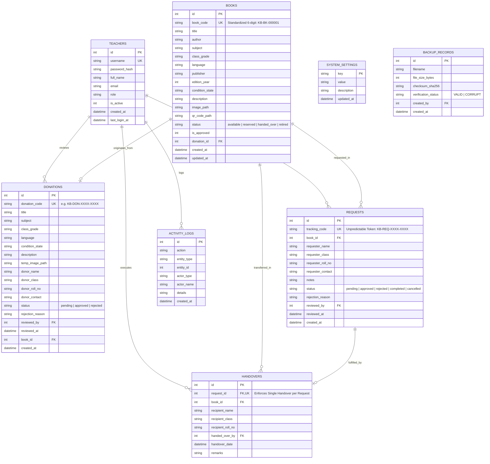

# Database Schema & Data Models (ERD)
## Project: Kitaab Bank – Smart School Book Exchange (کتاب بینک)

---

## 1. Entity-Relationship Diagram (ERD)



---

## 2. Table Specifications & Schema DDL

### 2.1 Database Pragmas & WAL Concurrency Configuration
Every database connection established by Flask must execute these initial PRAGMAs:
```sql
PRAGMA foreign_keys = ON;
PRAGMA journal_mode = WAL;
PRAGMA busy_timeout = 5000;
PRAGMA synchronous = NORMAL;
```
> [!IMPORTANT]
> **WAL Concurrency Reality:** WAL supports concurrent readers and **exactly ONE active writer at a time**. 
> All write transactions must use `BEGIN IMMEDIATE` and complete in milliseconds. Never perform network calls, file hashing, or image operations inside an open transaction.

### 2.2 `teachers` Table
```sql
CREATE TABLE IF NOT EXISTS teachers (
    id INTEGER PRIMARY KEY AUTOINCREMENT,
    username TEXT UNIQUE NOT NULL,
    password_hash TEXT NOT NULL,
    full_name TEXT NOT NULL,
    email TEXT,
    role TEXT NOT NULL DEFAULT 'teacher', -- 'admin', 'teacher'
    is_active INTEGER NOT NULL DEFAULT 1,
    created_at TIMESTAMP DEFAULT CURRENT_TIMESTAMP,
    last_login_at TIMESTAMP
);

CREATE INDEX IF NOT EXISTS idx_teachers_username ON teachers(username);
```

### 2.3 `books` Table
```sql
CREATE TABLE IF NOT EXISTS books (
    id INTEGER PRIMARY KEY AUTOINCREMENT,
    book_code TEXT UNIQUE NOT NULL, -- Standardized 6-digit Format: KB-BK-000001 (Deterministic padded sequence)
    title TEXT NOT NULL,
    author TEXT,
    subject TEXT NOT NULL, -- 'Mathematics', 'Science', 'English', 'Urdu', etc.
    class_grade TEXT NOT NULL, -- 'Class 6', 'Class 7', 'Class 8'
    language TEXT NOT NULL DEFAULT 'Urdu', -- 'Urdu', 'English', 'Sindhi'
    publisher TEXT,
    edition_year INTEGER,
    condition_state TEXT NOT NULL DEFAULT 'Good', -- 'Like New', 'Good', 'Fair'
    description TEXT,
    image_path TEXT, -- relative to static/uploads/books/
    qr_code_path TEXT, -- relative to static/uploads/qr/
    status TEXT NOT NULL DEFAULT 'available', -- 'available', 'reserved', 'handed_over', 'retired'
    is_approved INTEGER NOT NULL DEFAULT 1,
    donation_id INTEGER,
    created_at TIMESTAMP DEFAULT CURRENT_TIMESTAMP,
    updated_at TIMESTAMP DEFAULT CURRENT_TIMESTAMP,
    FOREIGN KEY (donation_id) REFERENCES donations(id) ON DELETE SET NULL
);

CREATE INDEX IF NOT EXISTS idx_books_status_grade ON books(status, class_grade);
CREATE INDEX IF NOT EXISTS idx_books_code ON books(book_code);
CREATE INDEX IF NOT EXISTS idx_books_subject ON books(subject);
```

### 2.4 `donations` Table
```sql
CREATE TABLE IF NOT EXISTS donations (
    id INTEGER PRIMARY KEY AUTOINCREMENT,
    donation_code TEXT UNIQUE NOT NULL, -- Cryptographically random: KB-DON-XXXX-XXXX
    title TEXT NOT NULL,
    subject TEXT NOT NULL,
    class_grade TEXT NOT NULL,
    language TEXT NOT NULL DEFAULT 'Urdu',
    condition_state TEXT NOT NULL DEFAULT 'Good',
    description TEXT,
    temp_image_path TEXT,
    donor_name TEXT NOT NULL,
    donor_class TEXT NOT NULL,
    donor_roll_no TEXT NOT NULL,
    donor_contact TEXT,
    status TEXT NOT NULL DEFAULT 'pending', -- 'pending', 'approved', 'rejected'
    rejection_reason TEXT,
    reviewed_by INTEGER,
    reviewed_at TIMESTAMP,
    book_id INTEGER,
    created_at TIMESTAMP DEFAULT CURRENT_TIMESTAMP,
    FOREIGN KEY (reviewed_by) REFERENCES teachers(id) ON DELETE SET NULL,
    FOREIGN KEY (book_id) REFERENCES books(id) ON DELETE SET NULL
);

CREATE INDEX IF NOT EXISTS idx_donations_status ON donations(status);
CREATE INDEX IF NOT EXISTS idx_donations_code ON donations(donation_code);
```

### 2.5 `requests` Table
```sql
CREATE TABLE IF NOT EXISTS requests (
    id INTEGER PRIMARY KEY AUTOINCREMENT,
    tracking_code TEXT UNIQUE NOT NULL, -- High-entropy secure token: KB-REQ-XXXX-XXXX
    book_id INTEGER NOT NULL,
    requester_name TEXT NOT NULL,
    requester_class TEXT NOT NULL,
    requester_roll_no TEXT NOT NULL,
    requester_contact TEXT NOT NULL,
    notes TEXT,
    status TEXT NOT NULL DEFAULT 'pending', -- 'pending', 'approved', 'rejected', 'completed', 'cancelled'
    rejection_reason TEXT,
    reviewed_by INTEGER,
    reviewed_at TIMESTAMP,
    created_at TIMESTAMP DEFAULT CURRENT_TIMESTAMP,
    FOREIGN KEY (book_id) REFERENCES books(id) ON DELETE RESTRICT,
    FOREIGN KEY (reviewed_by) REFERENCES teachers(id) ON DELETE SET NULL
);

CREATE INDEX IF NOT EXISTS idx_requests_tracking ON requests(tracking_code);
CREATE INDEX IF NOT EXISTS idx_requests_status ON requests(status);
CREATE INDEX IF NOT EXISTS idx_requests_book ON requests(book_id);
```

### 2.6 `handovers` Table
```sql
CREATE TABLE IF NOT EXISTS handovers (
    id INTEGER PRIMARY KEY AUTOINCREMENT,
    request_id INTEGER NOT NULL UNIQUE, -- Crucial: Prevents double-handover of same request
    book_id INTEGER NOT NULL,
    recipient_name TEXT NOT NULL,
    recipient_class TEXT NOT NULL,
    recipient_roll_no TEXT NOT NULL,
    handed_over_by INTEGER NOT NULL,
    handover_date TIMESTAMP DEFAULT CURRENT_TIMESTAMP,
    remarks TEXT,
    FOREIGN KEY (request_id) REFERENCES requests(id) ON DELETE RESTRICT,
    FOREIGN KEY (book_id) REFERENCES books(id) ON DELETE RESTRICT,
    FOREIGN KEY (handed_over_by) REFERENCES teachers(id) ON DELETE RESTRICT
);

CREATE INDEX IF NOT EXISTS idx_handovers_date ON handovers(handover_date);
CREATE INDEX IF NOT EXISTS idx_handovers_book ON handovers(book_id);
```

### 2.7 `activity_logs` Table
```sql
CREATE TABLE IF NOT EXISTS activity_logs (
    id INTEGER PRIMARY KEY AUTOINCREMENT,
    action TEXT NOT NULL,
    entity_type TEXT NOT NULL,
    entity_id INTEGER,
    actor_type TEXT NOT NULL DEFAULT 'system', -- 'teacher', 'student', 'system'
    actor_name TEXT,
    details TEXT,
    created_at TIMESTAMP DEFAULT CURRENT_TIMESTAMP
);

CREATE INDEX IF NOT EXISTS idx_activity_created ON activity_logs(created_at);
```

### 2.8 `system_settings` Table
```sql
CREATE TABLE IF NOT EXISTS system_settings (
    key TEXT PRIMARY KEY,
    value TEXT NOT NULL,
    description TEXT,
    updated_at TIMESTAMP DEFAULT CURRENT_TIMESTAMP
);
```

### 2.9 `backup_records` Table
```sql
CREATE TABLE IF NOT EXISTS backup_records (
    id INTEGER PRIMARY KEY AUTOINCREMENT,
    filename TEXT NOT NULL UNIQUE,
    file_size_bytes INTEGER NOT NULL,
    checksum_sha256 TEXT NOT NULL,
    verification_status TEXT NOT NULL DEFAULT 'VALID', -- 'VALID', 'CORRUPT'
    created_by INTEGER,
    created_at TIMESTAMP DEFAULT CURRENT_TIMESTAMP,
    FOREIGN KEY (created_by) REFERENCES teachers(id) ON DELETE SET NULL
);
```

---

## 3. Strict State Transition & Transaction Rules

### 3.1 Reservation Lock Execution (`BEGIN IMMEDIATE`)
When a teacher approves a student's book request, race conditions are eliminated using `BEGIN IMMEDIATE` with an atomic rowcount check:
```python
def approve_request_atomic(db_conn, request_id, book_id, teacher_id):
    # Begins write transaction immediately, acquiring reserved lock up front
    db_conn.execute("BEGIN IMMEDIATE")
    try:
        # Atomic reservation check: only transitions if book is currently 'available'
        cur = db_conn.execute(
            "UPDATE books SET status = 'reserved', updated_at = CURRENT_TIMESTAMP WHERE id = ? AND status = 'available';",
            (book_id,)
        )
        if cur.rowcount == 0:
            db_conn.execute("ROLLBACK")
            return False, "This book has already been reserved or handed over to another student."

        # Mark request as approved
        db_conn.execute(
            "UPDATE requests SET status = 'approved', reviewed_by = ?, reviewed_at = CURRENT_TIMESTAMP WHERE id = ?;",
            (teacher_id, request_id)
        )
        db_conn.execute("COMMIT")
        return True, "Request successfully approved and book reserved."
    except Exception as e:
        db_conn.execute("ROLLBACK")
        raise e
```

### 3.2 Double Handover Prevention
- Physical handovers require `handovers.request_id` to be unique.
- The handover transaction verifies that `books.status == 'reserved'` before writing to `handovers`, updating `books.status = 'handed_over'`, and updating `requests.status = 'completed'`.
- Any attempt to duplicate a handover raises a SQLite constraint violation, which is handled gracefully with an error flash.

### 3.3 Tracking Code Database Uniqueness & Collision Handling
- `requests.tracking_code` enforces a database-level `UNIQUE` constraint.
- Insertion service generates a high-entropy cryptographically random token (`secrets` module) inside a retry loop:
  ```python
  def create_student_request(db_conn, book_id, student_data):
      max_attempts = 5
      for attempt in range(max_attempts):
          code = generate_secure_tracking_code()
          try:
              db_conn.execute(
                  "INSERT INTO requests (tracking_code, book_id, requester_name, requester_class, requester_roll_no, requester_contact, notes) "
                  "VALUES (?, ?, ?, ?, ?, ?, ?);",
                  (code, book_id, student_data['name'], student_data['class'], student_data['roll_no'], student_data['contact'], student_data.get('notes', ''))
              )
              db_conn.commit()
              return code
          except sqlite3.IntegrityError:
              # Collision occurred (chance < 1 in 1 trillion) -> retry with a fresh token
              continue
      raise RuntimeError("Failed to generate a unique tracking code after multiple attempts.")
  ```

### 3.4 Live Snapshot Backup & Integrity Verification
- Backups utilize Python SQLite's native `connection.backup()` method.
- **Consistent Live Snapshot:** It copies database pages incrementally. While it briefly acquires shared read locks per step without freezing the application, it does not guarantee 100% lock-free execution (brief microsecond read locks occur).
- All backups must pass `PRAGMA integrity_check;` and schema verification before being recorded into `backup_records`.
