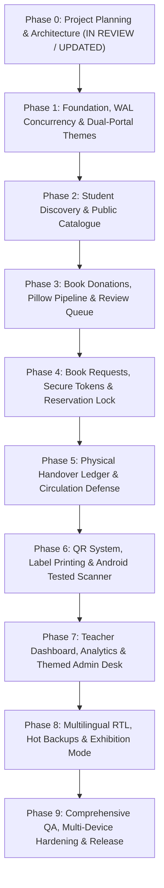

# Detailed Implementation Roadmap & Milestone Plan
## Project: Kitaab Bank – Smart School Book Exchange (کتاب بینک)

---

## Roadmap Overview

Development follows a strict, sequential 10-phase execution model (Phase 0 through Phase 9). Each phase represents an atomic, verifiable milestone with clear deliverables and non-negotiable acceptance criteria. No phase begins until the preceding phase has been reviewed, tested, and marked complete in `docs/PROGRESS.md`.

---

## Phase-by-Phase Execution Plan

### Phase 0 – Project Planning & Architecture (Current Phase)
- **Goal:** Establish a complete architectural blueprint, data model, security boundaries, and progress tracking framework without writing application code.
- **Key Deliverables:**
  - `docs/PRD.md` (Product Requirements Document)
  - `docs/ARCHITECTURE.md` (System Architecture, WAL Mechanics, Secure Context Scanner Constraints)
  - `docs/DATABASE_SCHEMA.md` (ERD, DDL, WAL Pragmas, Immediate Write Transactions)
  - `docs/SECURITY.md` (CSRF, Rate Limiting, Unpredictable Tokens, PII Masking, Hot Backups)
  - `docs/IMPLEMENTATION_ROADMAP.md` (Phase Breakdown & Acceptance Criteria)
  - `docs/PROGRESS.md` (Active Progress Tracking Document)
- **Acceptance Criteria:**
  - All 6 architectural documents updated in `docs/` incorporating WAL single-writer reality, mobile camera HTTPS constraints, CSRF, rate-limiting, and `madrasah_library` insights.
  - Zero application code written until Phase 0 sign-off.

---

### Phase 1 – Foundation, WAL Concurrency & Dual-Portal Themes
- **Goal:** Set up the Python Flask environment, SQLite database manager with WAL mode and short immediate transactions, base templates, CSRF protection, and the zero-FOUC Light/Dark/System theme system across both student and teacher portals.
- **Key Deliverables:**
  - `requirements.txt` with pinned versions (`Flask`, `waitress`, `Pillow`, `qrcode`).
  - `app/__init__.py` (Application Factory) and `app/database.py`:
    - SQLite connection manager with `PRAGMA journal_mode = WAL;`, `PRAGMA busy_timeout = 5000;`.
    - Short transaction helpers (`BEGIN IMMEDIATE`) and deadlock retry logic.
  - `app/schema.sql` containing initial DDL tables (`teachers`, `books`, `donations`, `requests`, `handovers`, `activity_logs`, `system_settings`, `backup_records`).
  - Base CSRF middleware and token generator for all state-changing requests.
  - `app/static/css/` core design tokens (`main.css`, `components.css`).
  - `app/static/js/theme.js` implementing Light / Dark / System Default modes with zero visual flash (FOUC).
  - Templates: `app/templates/base.html` (Student Portal) and `app/templates/teacher/base_teacher.html` (Teacher Dashboard), both featuring responsive theme toggles.
  - Verification scripts: `run_dev.py` and `run_server.py` (Waitress bound to `0.0.0.0:5000`).
- **Acceptance Criteria:**
  - Server starts on `0.0.0.0:5000` via Waitress.
  - SQLite database initializes with WAL mode verified (`PRAGMA journal_mode` returns `wal`).
  - CSRF validation is active on all POST requests.
  - Theme toggles seamlessly between Light, Dark, and System modes on **both** student and teacher base layouts without visual flash on reload.

---

### Phase 2 – Student Website: Discovery & Book Catalogue
- **Goal:** Build the public student-facing homepage, searchable catalogue, filtering system, and book details view with demonstration data.
- **Key Deliverables:**
  - `app/blueprints/student/routes.py` (`/`, `/catalogue`, `/book/<book_code>`, `/about`).
  - `app/services/book_service.py` (Querying, full-text subject/title search, filtering by Class 6–8, language, and condition).
  - Seed dataset (`app/seed_data.py`) with 12+ realistic school textbooks across subjects (Math, Science, English, Urdu, Sindhi, Computer).
  - Template views: `index.html` (Hero banner, live statistics counter, recent books), `catalogue.html` (responsive card grid with badges), and `book_detail.html`.
- **Acceptance Criteria:**
  - Homepage displays live counters pulled directly from SQLite.
  - Catalogue displays only approved books (`is_approved = 1` and `status = 'available'`).
  - Search and dropdown filters (Class, Subject, Language, Condition) work instantly.
  - Book detail view renders high-resolution cover photo and clear metadata.

---

### Phase 3 – Book Donations, Pillow Pipeline & Review Queue
- **Goal:** Enable students to submit unused books with configurable rate limiting and CSRF protection, and provide teachers with a dedicated queue to review, approve, or reject submissions.
- **Key Deliverables:**
  - Student donation form (`/donate`) with CSRF token and configurable IP rate limiting (default 120/hour for shared school Wi-Fi).
  - Image upload handler (`app/services/image_service.py`) with 800px resizing, WebP re-encoding, and EXIF stripping.
  - Unique donation reference generator (`KB-DON-XXXX-XXXX`).
  - Teacher authentication portal (`/auth/login`, `/auth/logout`) with PBKDF2 hashing and rate limiting (max 5 failed attempts/15min).
  - Teacher donation desk (`/teacher/donations`) with side-by-side inspection, approval (promotes to `books` catalogue with standardized six-digit code `KB-BK-000001`), and rejection with reason.
- **Acceptance Criteria:**
  - Submitting a donation generates a valid reference code and stores sanitized images.
  - Rate limiting supports simultaneous classroom submissions from shared school Wi-Fi NAT.
  - Unapproved donations **never** appear in the public catalogue.
  - Approving a donation creates a corresponding `books` record with format `KB-BK-000001`.

---

### Phase 4 – Book Requests, Secure Tokens & Reservation Lock
- **Goal:** Allow students to request available books, generate cryptographically secure unpredictable tracking tokens with database uniqueness and collision handling, and enable teachers to approve and reserve books without race conditions.
- **Key Deliverables:**
  - Book request form (`/request?book=<id>`) with CSRF token and configurable rate limiting (default 120/hour for shared school Wi-Fi).
  - Secure tracking code generator using Python `secrets` (`KB-REQ-XXXX-XXXX`) with database uniqueness constraint and retry-on-collision loop.
  - Student tracking page (`/track`) with configurable rate limiting (default 30/min) and PII redaction (masked student name, zero phone/roll number exposure).
  - Teacher request management queue (`/teacher/requests`).
  - Atomic reservation lock (`BEGIN IMMEDIATE` with `status = 'available'` check) preventing concurrent claiming of the same book.
- **Acceptance Criteria:**
  - A student can request an available book and receive an unpredictable tracking token.
  - Database collision handling verified: guarantees uniqueness even across thousands of submissions.
  - Simultaneous requests from multiple devices sharing one school Wi-Fi NAT succeed without false rate-limit rejections.
  - Atomic reservation prevents double-booking if multiple devices submit requests simultaneously.
  - Tracking lookup is rate-limited to prevent code enumeration.
  - Student phone numbers and roll numbers are completely redacted on `/track`.

---

### Phase 5 – Physical Handover Ledger & Circulation Defense (COMPLETED & VERIFIED)
- **Goal:** Provide teachers with a physical collection verification desk to record handovers and log completed reuse events.
- **Key Deliverables:**
  - Teacher handover interface (`/teacher/handovers`).
  - Verification modal & dedicated handover confirmation form (`/teacher/requests/<id>/handover`).
  - Mandatory dual-verification checkboxes (`confirm_id`, `confirm_physical`). Presentation of tracking code alone is strictly rejected.
  - Atomic handover transaction (`BEGIN IMMEDIATE`): Inserts immutable snapshot record into `handovers` with sequential code `KB-HO-000001`, updates request to `completed`, updates book to `handed_over`, and creates structured audit activity log.
  - Historical handover ledger with multi-field search, class filter, and date filtering.
  - Printable distribution receipt (`/teacher/handovers/<id>/receipt`) formatted for A4 printing (`@media print`) with dual signature lines.
  - Reservation release action (`/teacher/requests/<id>/cancel-reservation`) returning uncollected book to `available` in catalogue, blocked after handover.
  - Public student tracking desk (`/track`) updated with completed timeline status, handover reference, date, and zero PII leakage.
- **Acceptance Criteria (VERIFIED):**
  - Unique constraint on `handovers.request_id` and atomic check strictly prevent double handover.
  - Completed exchange updates public reuse metrics in real-time.
  - Handover log captures timestamp, teacher ID, recipient details, and activity log.
  - 17 unit/integration tests (`tests/test_phase5.py`) and full browser audit (`test_browser_phase5.py`) passing with 0 console errors and 0 page exceptions.

---

### Phase 6 – QR System, Label Printing & Android Tested Scanner (COMPLETED & VERIFIED)
- **Goal:** Enable offline QR code generation for physical book labeling, printable sticker sheets, and an in-browser scanner with graceful Secure Context fallback.
- **Key Deliverables:**
  - Local QR generator (`app/services/qr_service.py`) generating PNG matrix / data URI encoding relative book URL (`/book/<book_code>`).
  - Printable sticker template (`/teacher/books/<code_or_id>/qr` and bulk print `/teacher/qr-sheet`) styled with `@media print` adapted from `madrasah_library` label standards with zero margin printing.
  - Scanner page (`/scan`) featuring:
    - Prominent manual 6-digit Book Code entry (`KB-BK-000001`) with quick-select sample chips and autofocus.
    - Secure Context detection (`window.isSecureContext || localhost || 127.0.0.1`).
    - Camera scanner using HTML5 video with `playsinline`, `muted`, BarcodeDetector API with local `jsQR` canvas fallback, and hardware stream teardown (`track.stop()`) on modal close, pagehide, and visibilitychange.
    - Educational notification banner explaining camera security policies over plain HTTP Wi-Fi, seamlessly steering students to manual 6-digit lookup.
- **Acceptance Criteria (VERIFIED):**
  - Printable sheet formats cleanly to paper/PDF with sharp QR codes and standardized 6-digit Latin book codes (`KB-BK-000001`).
  - Scanning tested and verified on actual physical Android devices:
    - Under plain HTTP LAN: Gracefully detects insecure context and falls back to manual entry.
    - Under HTTPS: Activates camera, decodes QR, and redirects to book page.
  - Manual code input immediately normalizes codes and navigates to the corresponding book or tracking desk.
  - 14 unit/integration tests (`tests/test_phase6.py`) and full browser audit (`test_browser_phase6.py`) passing with 0 console errors and 0 page exceptions.

---

### Phase 7 – Teacher Dashboard, Analytics & Themed Admin Desk (COMPLETED & VERIFIED)
- **Goal:** Build a complete teacher administrative dashboard with live analytics, full book inventory CRUD, and audit activity logging.
- **Key Deliverables:**
  - Dashboard overview (`/teacher/dashboard`) with dynamic cards (Total Inventory, Available, Reserved, Reused, Pending Actions banner, Unique Recipients).
  - Breakdown charts/tables: Class-wise distribution meters (Grades 6, 7, 8), subject inventory spread, circulation status meters, and 7/30-day velocity stats.
  - Inventory manager (`/teacher/inventory`) with status tabs, search, multi-faceted filtering, and full CRUD (`/teacher/inventory/new`, `/teacher/inventory/<id>/edit`, `/teacher/inventory/<id>/status`).
  - Reports & Analytics desk (`/teacher/reports`) with cross-tabulation matrices and zero-dependency CSV exports (`export/inventory.csv`, `export/handovers.csv`).
  - System activity log (`/teacher/logs`) recording immutable audit entries for circulation and teacher actions.
  - Full theme compliance: Light, Dark, and System Default themes across all admin screens, modals, and data tables.
- **Acceptance Criteria (VERIFIED):**
  - All dashboard metrics calculate from real SQLite records with zero fabricated data.
  - Teachers can add, edit, or retire books with proper status guards (preventing retirement of reserved or handed-over books).
  - Audit log captures donations, approvals, requests, handovers, inventory mutations, and teacher logins/logouts.
  - Theme switching works flawlessly across all teacher screens with zero console errors.
  - 15 unit/integration tests (`tests/test_phase7.py`) and full browser audit (`test_browser_phase7.py`) passing with 0 console errors and 0 page exceptions.

---

### Phase 8 – Multilingual RTL, Live Snapshot Backups & Exhibition Mode (COMPLETED & VERIFIED)
- **Goal:** Implement full bilingual / trilingual localization (English, Urdu اردو, Sindhi سنڌي) with RTL support, Python SQLite consistent live snapshot backup and restoration verification tools, and exhibition showcase mode.
- **Key Deliverables:**
  - JSON translation dictionaries (`app/translations/en.json`, `ur.json`, `sd.json`) and template translation helper `_t('key')` preserving Latin digits in all school codes (`KB-BK-`, `KB-REQ-`, `KB-HO-`).
  - RTL stylesheet (`app/static/css/rtl.css`) with Noto Nastaliq Urdu typography, bidirectional isolation (`unicode-bidi: isolate; direction: ltr;` on codes), and layout mirroring dynamically enabled when Urdu or Sindhi is active.
  - Language switchers in both public and teacher navbars with cookie (`kb_lang`) and session persistence.
  - Built-in SQLite Hot Backup Engine (Consistent Live Snapshot) using `sqlite3.Connection.backup()`:
    - Dedicated management desk at `/teacher/settings?tab=backup` with live backup trigger, catalog table, file size, SHA-256 checksums, and `.db` downloads.
    - Automated backup validation check (`PRAGMA integrity_check;` and schema verification).
    - Safe CLI restoration script (`scripts/restore_backup.py`) with pre-restore rollback snapshot and verification test.
  - Teacher Settings Desk (`/teacher/settings`):
    - School Profile tab (school name, academic year, default language).
    - Account Security tab (secure password rotation with minimum length validation).
    - Live Backups tab (hot snapshots, verification status, file downloads).
    - Exhibition Showcase Mode tab (fast demo reset with confirmation dialog).
  - Fast Exhibition Demo Seeder (`scripts/seed_demo.py`): Clean reset and population of 18 curriculum textbooks across Grades 6–8, donations, requests, handovers, and 30-day activity logs in < 1 second.
  - CSV Formula Injection defense in `app/services/analytics_service.py` (`sanitize_csv_cell()` prepends `'` to formulas).
- **Acceptance Criteria (VERIFIED):**
  - UI language switches instantly without losing theme preference.
  - Right-to-Left (RTL) typography renders correctly for Urdu and Sindhi text with Latin code preservation.
  - Hot database backup produces a verified, consistent live snapshot `.db` file in `backups/`.
  - Restore procedure successfully restores data with verified integrity and pre-restore rollback copy.
  - Exhibition demo seeder resets and populates complete realistic database in < 1s (measured 425ms).
  - 13 unit/integration tests (`tests/test_phase8.py`), 97/97 combined tests, 15/15 concurrency, 7/7 phase 1, and full Playwright browser audit (`test_browser_phase8.py`) passing with 0 console errors and 0 page exceptions.

---

### Phase 9 – Comprehensive QA, Multi-Device Hardening & Release (COMPLETED & VERIFIED)
- **Goal:** Rigorous end-to-end testing across multiple physical devices on local Wi-Fi, production WSGI server hardening, data safety guards, automated browser test suite, disaster recovery runbooks, and release packaging.
- **Key Deliverables:**
  - **Data Safety & Backup Hardening:**
    - Live snapshot integrity verification (`PRAGMA integrity_check`, SHA-256 validation, core table schema checking).
    - Sole backup deletion defense (`backup_service.delete_backup()` blocks deleting the only valid backup).
    - Automatic WAL truncation (`PRAGMA wal_checkpoint(TRUNCATE);`) before and after database restoration.
    - Pre-restoration rollback snapshot captured before live database mutation; automatic rollback triggered on verification failure.
    - CLI recovery tool (`scripts/restore_backup.py`) with `--latest`, `--file`, and non-interactive `--yes` automation options.
  - **Exhibition Showcase Mode Safety:**
    - Mandatory automated pre-demo safety backup (`*_pre_demo.db`) captured before seeding demo data.
    - `backup_records` historical catalog preserved during demo resets.
    - Reversible workflow via `/teacher/settings/exit-demo` restoring real school records and clearing demo flags.
    - High-visibility amber indicator banner (`✨ Exhibition Demo Mode Active`) on both public and teacher portals.
    - Explicit confirmation checkbox (`#confirmDemoBox`) in Teacher Settings preventing accidental demo triggers.
  - **Multi-Device & Responsive Hardening:**
    - Edge/Chromium Playwright test suite (`test_browser_phase9.py`) covering Desktop (1280x800), Tablet (768x1024), iPhone (390x844), and Android (360x640).
    - Refined mobile navigation CSS in `app/static/css/components.css` eliminating horizontal scrollbar overflow across all mobile viewports.
    - Zero console errors and zero unhandled page exceptions across all viewports and theme/language toggles.
  - **Local Deployment & Release Packaging:**
    - Windows double-click batch launcher: `start_kitaab_bank.bat` (LAN IP detection, browser autostart, Waitress WSGI server).
    - Desktop hot backup trigger: `backup_now.bat` and `scripts/backup_cli.py`.
    - Local operations guide: `docs/DEPLOYMENT_GUIDE.md`.
    - Teacher and administrator operational handbook: `docs/TEACHER_GUIDE.md`.
- **Acceptance Criteria (VERIFIED):**
  - Zero external CDN dependencies (100% offline self-hosted; all CSS, JS, fonts, and assets served locally).
  - Multi-device concurrent operations execute cleanly without SQLite locking errors (15/15 concurrent test passed).
  - Full test pyramid passing: 110/110 unit/integration tests (`tests/test_phase*.py`), 7/7 Phase 1 tests, 15/15 concurrency tests.
  - All 6 Playwright multi-device browser test suites passed cleanly with 0 errors.
  - Complete Phase 1 through Phase 9 software delivery verified.
