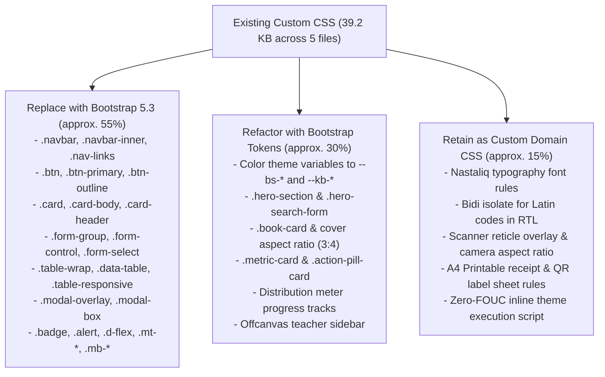
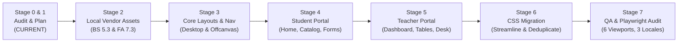

# KITAAB BANK — FRONTEND MODERNIZATION & UI/UX REDESIGN MASTER PLAN
## Architecture, Design System, CSS Migration & Implementation Blueprint

---

## 1. Executive Summary & Project Objectives

**Kitaab Bank (کتاب بینک) – Smart School Book Exchange** has successfully completed Development Phases 1 through 9. The backend application, database transactions, concurrency controls, security defenses, and data disaster recovery workflows are fully stabilized and verified by 128 automated unit tests, WAL concurrency stress tests, and multi-device browser suites.

This master plan governs a **dedicated frontend modernization initiative**. The objective is to elevate Kitaab Bank from functional prototypes and bespoke CSS styles into a **cohesive, professionally engineered, modern school library and exchange platform** without altering backend logic or compromising its strict **100% offline-first architecture**.

### Primary Objectives
1. **Bootstrap 5.3.8 Integration:** Replace brittle, repetitive custom CSS layouts, grids, flex containers, and components with native Bootstrap 5.3.8 utilities and components.
2. **Professional Design System:** Establish a unified educational design token system (colors, surfaces, elevation, typography, border-radii, spacing) shared cleanly across both portals.
3. **Font Awesome 7.3.1 Free Icons:** Eliminate inconsistent emoji and raw Unicode characters (`📖`, `👨‍🏫`, `🔍`, `✓`, `✕`, `⏳`, `🔒`, `🟢`, `🤝`, `▼`, `☰`); replace them with semantically structured, accessible Font Awesome icons.
4. **Desktop Navigation Text-Wrapping Resolution:** Re-architect the desktop navbar to guarantee zero label wrapping across standard desktop and laptop displays (1024px–1440px).
5. **Mobile Navigation Overhaul:** Replace the simple dropdown menu with a responsive, accessible Bootstrap Offcanvas drawer featuring large touch targets, backdrop dismissal, keyboard Esc trapping, and integrated locale/theme selectors.
6. **Student & Teacher Portal Modernization:** Elevate all 33 templates with consistent page headers, unified card elevations, accessible form controls, clean tables, and informative status badges.
7. **Trilingual & Bidirectional Preservation:** Seamlessly support English (LTR), Urdu (RTL), and Sindhi (RTL) utilizing official Bootstrap RTL stylesheets (`bootstrap.rtl.min.css`) and locally served Nastaliq typography, while strictly enforcing LTR bidi isolation for school codes (`KB-BK-000001`).
8. **Theme Persistence with Zero FOUC:** Preserve Light, Dark, and System Default themes integrated natively with Bootstrap's `data-bs-theme` attribute, ensuring zero flash of unstyled content.
9. **100% Offline Integrity:** Zero external CDNs (no Google Fonts, no Cloudflare, no unpkg, no external icon fonts). All assets must reside locally in `app/static/vendor/`.

---

## 2. Confirmed Project Scope

### In-Scope (Frontend Only)
- Auditing, organizing, and refactoring all existing stylesheets (`main.css`, `components.css`, `student.css`, `teacher.css`, `rtl.css`).
- Local integration of Bootstrap 5.3.8 (LTR & RTL CSS, bundle JS) and Font Awesome 7.3.1 Free (SVG/Webfonts & CSS).
- Modernization of all 33 Jinja2 templates (Student Portal, Teacher Portal, Auth, Errors, Printables).
- Redesign of Desktop Navigation, Mobile Offcanvas Navigation, and Teacher Sidebar Navigation.
- Centralized icon mapping dictionary and replacement of all decorative emoji/Unicode interface symbols.
- Responsive hardening across standard breakpoints: 1440px, 1280px, 1024px, 768px, 390px, 360px.
- Updating `theme.js` to coordinate with Bootstrap 5.3 `data-bs-theme` and Font Awesome icon switching.
- Comprehensive regression testing using the existing Playwright / Microsoft Edge suite.

### Strictly Out-of-Scope (Functional Non-Interference)
- **NO changes to Flask routing, view functions, or blueprint URLs.**
- **NO changes to SQLite database schema, migrations, or DDL.**
- **NO changes to transaction locking (`BEGIN IMMEDIATE`), concurrency timeouts, or WAL settings.**
- **NO changes to teacher authentication, session cookies, or CSRF token verification.**
- **NO changes to form field names, query parameter names, or POST payload structures.**
- **NO changes to element IDs and data attributes required by JavaScript (`qr_scanner.js`, `theme.js`).**
- **NO changes to backup creation, verification, CLI restore, or Exhibition Showcase Mode workflows.**
- **NO introduction of heavy JavaScript frameworks (React, Vue, Angular) or Node.js build pipelines.**

---

## 3. Technology Decisions & Offline Asset Architecture

### 3.1 Framework Selections
| Technology | Exact Version | Format / Distribution | Purpose |
|---|---|---|---|
| **Bootstrap** | **v5.3.8** | Precompiled CSS & Vanilla JS Bundle | Responsive grid, containers, offcanvas drawer, navbar, modals, badges, cards, forms, tables, utility classes. |
| **Bootstrap RTL** | **v5.3.8** | `bootstrap.rtl.min.css` | Native Right-to-Left bidirectional layout engine for Urdu and Sindhi locales. |
| **Font Awesome** | **v7.3.1 Free** | Local Webfonts (`woff2`) & `all.min.css` | Universal, professional iconography across all buttons, navigation, status badges, metrics, and alerts. |
| **jsQR & BarcodeDetector** | *Existing* | Local `app/static/js/jsqr.js` | Preserved offline client-side QR barcode scanning engine. |

### 3.2 Offline Vendor Directory Structure
All external assets will be stored locally within `app/static/vendor/` with complete license text and attribution:

```
app/static/
├── vendor/
│   ├── bootstrap/
│   │   ├── css/
│   │   │   ├── bootstrap.min.css            # Official Bootstrap 5.3.8 LTR
│   │   │   ├── bootstrap.min.css.map
│   │   │   ├── bootstrap.rtl.min.css        # Official Bootstrap 5.3.8 RTL
│   │   │   └── bootstrap.rtl.min.css.map
│   │   ├── js/
│   │   │   ├── bootstrap.bundle.min.js      # Bootstrap JS + Popper.js bundled
│   │   │   └── bootstrap.bundle.min.js.map
│   │   └── LICENSE                          # MIT License
│   │
│   └── fontawesome/
│       ├── css/
│       │   ├── all.min.css                  # Font Awesome 7.3.1 Free compiled CSS
│       │   └── fontawesome.min.css
│       ├── webfonts/
│       │   ├── fa-solid-900.woff2           # Solid icon font binary
│       │   ├── fa-solid-900.ttf
│       │   ├── fa-regular-400.woff2         # Regular icon font binary
│       │   └── fa-regular-400.ttf
│       └── LICENSE.txt                      # SIL OFL 1.1 / MIT License
```

### 3.3 Central Icon Mapping Dictionary
The application will replace all raw emoji and Unicode symbols with consistent, semantically accurate Font Awesome Solid (`fa-solid`) and Regular (`fa-regular`) icons:

| Existing Symbol / Emoji | Application Context | Proposed Font Awesome Icon | Usage Class |
|---|---|---|---|
| `📖` | Brand Logo / Book Entity | Open Book | `fa-solid fa-book-open` |
| `📚` | Library / Inventory / Catalogue | Stack of Books | `fa-solid fa-book-bookmark` |
| `👨‍🏫` | Teacher / Staff Portal | Teacher at Blackboard | `fa-solid fa-chalkboard-user` |
| `🏫` | School / Institution | School Building | `fa-solid fa-school` |
| `🎓` | Class Grade / Academic Year | Graduation Cap | `fa-solid fa-graduation-cap` |
| `🎒` | Student Program / Beneficiary | Child / Schoolbag | `fa-solid fa-child-reaching` |
| `🔍` | Search / Filter / Discover | Magnifying Glass | `fa-solid fa-magnifying-glass` |
| `➕` | Add Book / Create Record | Plus Symbol | `fa-solid fa-plus` |
| `✏️` | Edit Textbook / Manual Code | Pen to Square | `fa-solid fa-pen-to-square` |
| `✕` | Close / Dismiss / Reject / Clear | X-Mark | `fa-solid fa-xmark` |
| `✓` | Teacher Verified / Approved | Checkmark | `fa-solid fa-check` |
| `⏳` | Pending Review / In-Progress | Clock / Hourglass | `fa-regular fa-clock` |
| `🔒` | Reserved / Pickup Lock | Closed Padlock | `fa-solid fa-lock` |
| `🟢` | Available in Stock | Circle Check / Green Dot | `fa-solid fa-circle-check` |
| `🤝` | Physical Handover / Exchange | Handshake | `fa-solid fa-handshake` |
| `📥` | Donation Queue / Inbound | Inbox Tray | `fa-solid fa-inbox` |
| `📤` | Submit Request / Outbound | Paper Plane | `fa-solid fa-paper-plane` |
| `📋` | Request Queue / Audit Form | Clipboard List | `fa-solid fa-clipboard-list` |
| `🏷️` | QR Label / Sticker Sheet | Price Tag / QR | `fa-solid fa-tag` |
| `🖨️` | Print Receipt / Bulk Sheet | Printer | `fa-solid fa-print` |
| `📊` | Library Overview / Metrics | Chart Pie / Simple | `fa-solid fa-chart-pie` |
| `📈` | Circulation Reports | Chart Line | `fa-solid fa-chart-line` |
| `📜` | Activity Logs | Scroll / History | `fa-solid fa-clock-rotate-left` |
| `⚙️` | School Settings / Config | Gear / Cog | `fa-solid fa-gear` |
| `🔑` | Security / Password Rotation | Key | `fa-solid fa-key` |
| `💾` | Database Hot Backup | Database Disk | `fa-solid fa-database` |
| `🗑️` | Delete Backup File | Trash Can | `fa-solid fa-trash-can` |
| `✨` | Exhibition Showcase Mode | Wand / Sparkles | `fa-solid fa-wand-magic-sparkles` |
| `🌐` | Language Selector | Globe | `fa-solid fa-globe` |
| `☀️` | Light Theme Toggle | Sun | `fa-solid fa-sun` |
| `🌙` | Dark Theme Toggle | Moon | `fa-solid fa-moon` |
| `💻` | System Default Theme | Desktop Display | `fa-solid fa-desktop` |
| `☰` | Mobile Navbar Toggle | Bars / Hamburger | `fa-solid fa-bars` |
| `📷` | Camera Scanner Card | Camera | `fa-solid fa-camera` |
| `📹` | Video Feed Active | Video Camera | `fa-solid fa-video` |
| `⏹️` | Stop Camera Stream | Stop Square | `fa-solid fa-stop` |
| `🔄` | Flip Camera / Reset Filter | Arrows Rotate | `fa-solid fa-arrows-rotate` |
| `🔢` | Direct Code Lookup | Barcode / Numbers | `fa-solid fa-barcode` |
| `📞` | Contact / Phone Number | Phone | `fa-solid fa-phone` |
| `👤` | Student Requester / Donor | User Avatar | `fa-regular fa-user` |
| `👥` | Beneficiaries Count | Users Group | `fa-solid fa-users` |
| `📅` | Date Stamp / Handover Date | Calendar Days | `fa-regular fa-calendar-days` |
| `⚠️` | Warning Alert / Danger Zone | Triangle Exclamation | `fa-solid fa-triangle-exclamation` |
| `ℹ️` | Info Alert / Note | Circle Info | `fa-solid fa-circle-info` |
| `🛠️` | Maintenance Mode Banner | Screwdriver Wrench | `fa-solid fa-screwdriver-wrench` |
| `🛡️` | Security Defense / CSRF | Shield Halved | `fa-solid fa-shield-halved` |
| `▼` | Dropdown Indicator | Caret Down | `fa-solid fa-caret-down` |
| `↗` | External / Portal Switch Link | Arrow Up Right From Square | `fa-solid fa-arrow-up-right-from-square` |

---

## 4. Unified Design System Specification

### 4.1 Color Architecture & Semantic Tokens
Kitaab Bank employs an educational, approachable palette centered on **Educational Blue (`#0284c7`)** and **Scholastic Teal (`#0d9488`)**. All variables will integrate with Bootstrap 5.3's CSS variable architecture:

```css
:root, [data-bs-theme="light"], [data-theme="light"] {
  /* Brand Core */
  --kb-primary: #0284c7;
  --kb-primary-hover: #0369a1;
  --kb-primary-subtle: #e0f2fe;
  --kb-primary-border: #bae6fd;
  --kb-primary-text: #0369a1;

  --kb-accent: #0d9488;
  --kb-accent-hover: #0f766e;
  --kb-accent-subtle: #ccfbf1;

  /* Surfaces & Backgrounds */
  --kb-bg-body: #f8fafc;
  --kb-bg-surface: #ffffff;
  --kb-bg-surface-elevated: #ffffff;
  --kb-bg-muted: #f1f5f9;
  --kb-bg-subtle: #e2e8f0;

  /* Text & Hierarchy */
  --kb-text-primary: #0f172a;
  --kb-text-secondary: #475569;
  --kb-text-muted: #64748b;
  --kb-text-inverse: #ffffff;

  /* Borders & Dividers */
  --kb-border: #e2e8f0;
  --kb-border-subtle: #cbd5e1;
  --kb-border-strong: #94a3b8;

  /* Semantic Alerts */
  --kb-success: #16a34a;
  --kb-success-subtle: #dcfce7;
  --kb-success-text: #15803d;

  --kb-warning: #d97706;
  --kb-warning-subtle: #fef3c7;
  --kb-warning-text: #b45309;

  --kb-danger: #dc2626;
  --kb-danger-subtle: #fee2e2;
  --kb-danger-text: #b91c1c;

  --kb-info: #0284c7;
  --kb-info-subtle: #e0f2fe;
  --kb-info-text: #0369a1;

  /* Elevation */
  --kb-shadow-sm: 0 1px 2px 0 rgb(0 0 0 / 0.05);
  --kb-shadow-md: 0 4px 6px -1px rgb(0 0 0 / 0.08), 0 2px 4px -2px rgb(0 0 0 / 0.06);
  --kb-shadow-lg: 0 10px 15px -3px rgb(0 0 0 / 0.08), 0 4px 6px -4px rgb(0 0 0 / 0.04);
}

[data-bs-theme="dark"], [data-theme="dark"] {
  /* Brand Core */
  --kb-primary: #38bdf8;
  --kb-primary-hover: #7dd3fc;
  --kb-primary-subtle: #082f49;
  --kb-primary-border: #075985;
  --kb-primary-text: #bae6fd;

  --kb-accent: #2dd4bf;
  --kb-accent-hover: #5eead4;
  --kb-accent-subtle: #134e4a;

  /* Surfaces & Backgrounds */
  --kb-bg-body: #090d16;
  --kb-bg-surface: #111827;
  --kb-bg-surface-elevated: #1f2937;
  --kb-bg-muted: #1e293b;
  --kb-bg-subtle: #334155;

  /* Text & Hierarchy */
  --kb-text-primary: #f8fafc;
  --kb-text-secondary: #cbd5e1;
  --kb-text-muted: #94a3b8;
  --kb-text-inverse: #0f172a;

  /* Borders & Dividers */
  --kb-border: #1e293b;
  --kb-border-subtle: #334155;
  --kb-border-strong: #475569;

  /* Semantic Alerts */
  --kb-success: #22c55e;
  --kb-success-subtle: #052e16;
  --kb-success-text: #86efac;

  --kb-warning: #f59e0b;
  --kb-warning-subtle: #451a03;
  --kb-warning-text: #fcd34d;

  --kb-danger: #ef4444;
  --kb-danger-subtle: #450a0a;
  --kb-danger-text: #fca5a5;

  /* Elevation */
  --kb-shadow-sm: 0 1px 2px 0 rgb(0 0 0 / 0.4);
  --kb-shadow-md: 0 4px 6px -1px rgb(0 0 0 / 0.35);
  --kb-shadow-lg: 0 10px 15px -3px rgb(0 0 0 / 0.45);
}
```

### 4.2 Typography & Nastaliq Script Handling
- **Latin Font Stack:** `system-ui, -apple-system, "Segoe UI", Roboto, Helvetica, Arial, sans-serif`
- **Urdu & Sindhi Font Stack:** `"Noto Nastaliq Urdu", "Jameel Noori Nastaleeq", "Urdu Typesetting", "Arabic Typesetting", Tahoma, sans-serif`
- **Line Heights:**
  - English body: `1.5`
  - Urdu/Sindhi body: `1.75` (required for Nastaliq ascenders/descenders to prevent vertical glyph clipping)
  - Headings in RTL: `1.6`
- **Bidi Isolation Guard:**
  All book codes (`KB-BK-000001`), tracking tokens (`KB-REQ-XXXX-XXXX`), and handover references (`KB-HO-000001`) are strictly isolated with:
  ```css
  .kb-code, .book-code, .tracking-code, .handover-code, .font-mono {
    direction: ltr !important;
    display: inline-block;
    unicode-bidi: isolate;
    text-align: left;
    font-family: ui-monospace, SFMono-Regular, Menlo, Monaco, Consolas, monospace;
  }
  ```

### 4.3 Component Styling Standards
- **Buttons:** Min-height 42px on desktop, 48px touch target on mobile; `btn-primary`, `btn-outline-secondary`, `btn-success`, `btn-danger`.
- **Cards:** Rounded-3 (`12px`), 1px border (`var(--kb-border)`), soft shadow (`var(--kb-shadow-sm)`).
- **Forms:** Bootstrap `.form-label` with `.fw-semibold`, `.form-control` with focus ring `0 0 0 0.25rem rgba(2, 132, 199, 0.25)`.
- **Badges:** Pill badges (`rounded-pill px-3 py-1 fw-semibold`).
- **Tables:** Bootstrap `.table .table-hover .align-middle` wrapped in responsive `.table-responsive` cards.

---

## 5. CSS Audit & Migration Strategy

### 5.1 Existing Stylesheet Inventory
| Stylesheet | File Size | Primary Responsibilities | Redundancies / Issues |
|---|---|---|---|
| `main.css` | 4.5 KB | CSS variables, base reset, container, simple utility classes (`.d-flex`, `.gap-*`, `.mt-*`). | 80% duplicates standard Bootstrap utility classes. |
| `components.css` | 7.8 KB | Custom navbar, buttons, cards, badges, alerts, forms, tables, modals, theme dropdowns. | Entirely reinvents Bootstrap components with brittle bespoke CSS. |
| `student.css` | 14.1 KB | Hero section, book cards, filter panel, book detail, donate form, track timeline, scanner card. | Custom grid layouts (`grid-template-columns: repeat(...)`) that break on narrow viewports; extensive custom form wraps. |
| `teacher.css` | 10.1 KB | Teacher sidebar shell, metric cards, action pills, data tables, modals, settings tabs. | Custom sidebar collapses into 100% full-width block dumping 9 items above content on mobile; custom modal implementations. |
| `rtl.css` | 2.7 KB | Direction flipping, font family overrides, Nastaliq line heights, bidi isolation, print overrides. | Redundant when `bootstrap.rtl.min.css` is loaded; only Nastaliq fonts and code isolation rules need to be retained. |

### 5.2 Rule-by-Rule Classification & Migration Matrix



#### Detailed Action Items by Stylesheet:
1. **`main.css`:**
   - *Replace with Bootstrap:* Remove `.container`, `.d-flex`, `.align-center`, `.justify-between`, `.gap-*`, `.mt-*`, `.mb-*`, `.text-center`, `.text-muted`, `.text-bold`.
   - *Refactor:* Retain `--kb-*` design tokens, map to Bootstrap CSS variables (`--bs-primary`, `--bs-body-bg`, etc.).
   - *Retain:* Zero-FOUC theme guard script in `<head>`.
2. **`components.css`:**
   - *Replace with Bootstrap:* Replace bespoke navbar with Bootstrap `.navbar`, replace `.btn-*` with Bootstrap buttons, replace `.card` with Bootstrap cards, replace `.badge` with Bootstrap badges, replace `.alert` with Bootstrap alerts, replace `.table-wrap` and `.data-table` with `.table .table-hover .table-responsive`, replace custom modal classes with Bootstrap Modals (`modal`, `modal-dialog`, `modal-content`).
   - *Refactor:* Style Bootstrap dropdowns for Language and Theme selectors.
3. **`student.css`:**
   - *Replace with Bootstrap:* Replace `.form-grid-2`, `.donation-form-wrap`, `.filter-grid` with Bootstrap Grid (`.row .g-3 .col-md-6`, etc.).
   - *Refactor:* Book cards (`.book-card`) rewritten using Bootstrap `.card` with uniform aspect ratio cover wrap (`aspect-ratio: 3/4`).
   - *Retain:* Camera reticle scanner overlay animations and target bracket corners.
4. **`teacher.css`:**
   - *Replace with Bootstrap:* Replace `.teacher-shell` and `.teacher-sidebar` with Bootstrap Layout + Offcanvas drawer for screens < 992px (`lg`).
   - *Refactor:* Metric cards rewritten using Bootstrap grid cards (`col-12 col-sm-6 col-xl-3`).
   - *Retain:* Activity timeline badge indicators (`.badge-act-*`) and meter progress tracks (`.meter-track .meter-fill`).
5. **`rtl.css`:**
   - *Replace with Bootstrap:* Replace margin/padding direction flips (`margin-left: 0; margin-right: auto`) with Bootstrap logical utility classes (`ms-auto`, `me-auto`, `ps-3`, `pe-3`).
   - *Retain:* Nastaliq font declarations, RTL line height boosters (1.6 to 1.75), and `.kb-code` bidi isolation (`unicode-bidi: isolate; direction: ltr !important;`).
6. **Print Stylesheets:**
   - *Retain 100%:* All print layouts in `handover_receipt.html`, `book_qr_label.html`, `qr_sheet.html`, and `reports.html` (`@media print` rules, A4 page margins, page-break-inside avoid, label sticker dimensions).

---

## 6. Navigation Redesign Blueprint

### 6.1 Desktop Navigation (Fixing Text-Wrapping)

#### Root Cause Analysis of Current Defect
On desktop screens between 1024px and 1280px (and even up to 1366px in Urdu/Sindhi due to Nastaliq letterforms), the header links wrap to a second line.
- Left brand block takes ~220px.
- 6 Nav links (`Home`, `Browse Books`, `Donate a Book`, `Track Request`, `Scan QR`, `About`) take ~680px (English) to ~750px (Urdu/Sindhi).
- Right utility block (Language dropdown + Theme dropdown + Teacher Login button) takes ~390px.
- Total required horizontal space: **~1,290px to 1,360px**, which exceeds the standard 1024px–1200px container width!
- Because `.nav-links` is not collapsed until `768px`, screens between 769px and 1300px experience ugly label wrapping, broken alignment, and vertical overflow.

#### The Architectural Solution
1. **Bootstrap Navbar with `navbar-expand-xl` Breakpoint:**
   Collapse navigation into an offcanvas hamburger menu on all viewports below `1200px` (`xl`). On viewports ≥ 1200px, all items fit comfortably on a single line with generous spacing.
2. **Compact Navigation Labels & Spacing:**
   Use Bootstrap's responsive utilities (`gap-xl-2 gap-xxl-3`, `px-xl-2 px-xxl-3`) and concise translations.
3. **Consolidated Right Utility Group:**
   Group the Language, Theme, and Teacher Auth controls into a sleek, compact button group with Font Awesome icons.
4. **Zero-Wrap Guarantee:**
   Enforce `.navbar-nav .nav-link { white-space: nowrap; }` exclusively inside the `navbar-expand-xl` media query where adequate horizontal container width is guaranteed.

```html
<!-- Proposed Desktop Navbar Structure (Student Portal) -->
<nav class="navbar navbar-expand-xl navbar-light bg-surface sticky-top border-bottom">
  <div class="container">
    <!-- Brand -->
    <a class="navbar-brand d-flex align-items-center gap-2" href="{{ url_for('student.index') }}">
      <div class="brand-logo-icon"><i class="fa-solid fa-book-open"></i></div>
      <div class="d-flex flex-column">
        <span class="brand-title">{{ _t('app_name', 'Kitaab Bank') }}</span>
        <span class="brand-subtitle d-none d-sm-inline">{{ _t('app_tagline', 'Smart School Book Exchange') }}</span>
      </div>
    </a>

    <!-- Mobile Offcanvas Trigger Button -->
    <button class="navbar-toggler border-0 shadow-none d-xl-none" type="button" data-bs-toggle="offcanvas" data-bs-target="#studentNavOffcanvas" aria-controls="studentNavOffcanvas" aria-label="Toggle navigation">
      <i class="fa-solid fa-bars fs-4"></i>
    </button>

    <!-- Desktop Navigation Links (>= 1200px) -->
    <div class="collapse navbar-collapse d-none d-xl-flex justify-content-between">
      <ul class="navbar-nav mx-auto gap-1 gap-xxl-2">
        <li class="nav-item"><a class="nav-link active" href="{{ url_for('student.index') }}"><i class="fa-solid fa-house me-1"></i>{{ _t('nav_home', 'Home') }}</a></li>
        <li class="nav-item"><a class="nav-link active" href="{{ url_for('student.catalogue') }}"><i class="fa-solid fa-book-bookmark me-1"></i>{{ _t('nav_catalogue', 'Browse Books') }}</a></li>
        <li class="nav-item"><a class="nav-link active" href="{{ url_for('student.donate') }}"><i class="fa-solid fa-hand-holding-heart me-1"></i>{{ _t('nav_donate', 'Donate a Book') }}</a></li>
        <li class="nav-item"><a class="nav-link active" href="{{ url_for('student.track') }}"><i class="fa-solid fa-magnifying-glass me-1"></i>{{ _t('nav_track', 'Track Request') }}</a></li>
        <li class="nav-item"><a class="nav-link active" href="{{ url_for('student.scan') }}"><i class="fa-solid fa-qrcode me-1"></i>{{ _t('nav_scan', 'Scan QR') }}</a></li>
        <li class="nav-item"><a class="nav-link active" href="{{ url_for('student.about') }}"><i class="fa-solid fa-circle-info me-1"></i>{{ _t('nav_about', 'About') }}</a></li>
      </ul>

      <!-- Desktop Utility Actions -->
      <div class="d-flex align-items-center gap-2">
        <!-- Language Dropdown -->
        <div class="dropdown">
          <button class="btn btn-outline-secondary btn-sm dropdown-toggle rounded-pill" type="button" data-bs-toggle="dropdown" aria-expanded="false">
            <i class="fa-solid fa-globe me-1"></i><span>{{ supported_languages[current_lang].native_name }}</span>
          </button>
          <ul class="dropdown-menu dropdown-menu-end shadow-sm">
            
            <li><a class="dropdown-item active" href="{{ url_for('set_language', lang_code=code) }}">{{ lang_info.native_name }} ({{ lang_info.name }})</a></li>
            
          </ul>
        </div>

        <!-- Theme Dropdown -->
        <div class="dropdown">
          <button class="btn btn-outline-secondary btn-sm dropdown-toggle rounded-pill" type="button" data-bs-toggle="dropdown" aria-expanded="false">
            <span data-theme-icon><i class="fa-solid fa-sun"></i></span>
          </button>
          <ul class="dropdown-menu dropdown-menu-end shadow-sm">
            <li><button class="dropdown-item" type="button" data-theme-set="light"><i class="fa-solid fa-sun me-2 text-warning"></i>{{ _t('theme_light', 'Light Mode') }}</button></li>
            <li><button class="dropdown-item" type="button" data-theme-set="dark"><i class="fa-solid fa-moon me-2 text-primary"></i>{{ _t('theme_dark', 'Dark Mode') }}</button></li>
            <li><button class="dropdown-item" type="button" data-theme-set="system"><i class="fa-solid fa-desktop me-2 text-muted"></i>{{ _t('theme_system', 'System Default') }}</button></li>
          </ul>
        </div>

        <!-- Teacher Desk Button -->
        
          <a href="{{ url_for('teacher.dashboard') }}" class="btn btn-primary btn-sm rounded-pill"><i class="fa-solid fa-chalkboard-user me-1"></i>{{ _t('nav_teacher', 'Teacher Desk') }}</a>
          <a href="{{ url_for('auth.logout') }}" class="btn btn-outline-danger btn-sm rounded-pill" title="Sign Out"><i class="fa-solid fa-arrow-right-from-bracket"></i></a>
        
          <a href="{{ url_for('auth.login') }}" class="btn btn-outline-primary btn-sm rounded-pill"><i class="fa-solid fa-user-tie me-1"></i>{{ _t('nav_login', 'Teacher Sign In') }}</a>
        
      </div>
    </div>
  </div>
</nav>
```

### 6.2 Mobile Navigation (Offcanvas Drawer Experience)

#### Requirements & Architecture
- **Slide-in Drawer:** Utilizing Bootstrap 5.3 `.offcanvas-start` (for LTR English) and `.offcanvas-end` (for RTL Urdu/Sindhi).
- **Background Scroll Locking:** Native Bootstrap offcanvas backdrop prevents touch scroll passthrough to page content.
- **Accessible Escape & Focus Trap:** Built-in keyboard Esc trapping and accessible dismiss button.
- **Large Touch Targets:** Minimum 48px height per navigation item with icons and active state highlights.
- **Integrated Mobile Footer:** Language selection pills and theme toggle buttons placed inside the offcanvas footer.

```html
<!-- Proposed Mobile Offcanvas Drawer (Student Portal) -->
<div class="offcanvas offcanvas-endoffcanvas-start d-xl-none" tabindex="-1" id="studentNavOffcanvas" aria-labelledby="studentNavOffcanvasLabel">
  <div class="offcanvas-header border-bottom">
    <div class="d-flex align-items-center gap-2" id="studentNavOffcanvasLabel">
      <div class="brand-logo-icon"><i class="fa-solid fa-book-open"></i></div>
      <span class="fw-bold fs-5">{{ _t('app_name', 'Kitaab Bank') }}</span>
    </div>
    <button type="button" class="btn-close text-reset shadow-none" data-bs-dismiss="offcanvas" aria-label="Close"></button>
  </div>

  <div class="offcanvas-body d-flex flex-column justify-content-between p-3">
    <!-- Navigation Links -->
    <ul class="nav nav-pills flex-column gap-2">
      <li class="nav-item">
        <a class="nav-link py-3 px-3 d-flex align-items-center gap-3 active" href="{{ url_for('student.index') }}">
          <i class="fa-solid fa-house fs-5 text-primary"></i>
          <span class="fs-6 fw-medium">{{ _t('nav_home', 'Home') }}</span>
        </a>
      </li>
      <li class="nav-item">
        <a class="nav-link py-3 px-3 d-flex align-items-center gap-3 active" href="{{ url_for('student.catalogue') }}">
          <i class="fa-solid fa-book-bookmark fs-5 text-primary"></i>
          <span class="fs-6 fw-medium">{{ _t('nav_catalogue', 'Browse Books') }}</span>
        </a>
      </li>
      <li class="nav-item">
        <a class="nav-link py-3 px-3 d-flex align-items-center gap-3 active" href="{{ url_for('student.donate') }}">
          <i class="fa-solid fa-hand-holding-heart fs-5 text-success"></i>
          <span class="fs-6 fw-medium">{{ _t('nav_donate', 'Donate a Book') }}</span>
        </a>
      </li>
      <li class="nav-item">
        <a class="nav-link py-3 px-3 d-flex align-items-center gap-3 active" href="{{ url_for('student.track') }}">
          <i class="fa-solid fa-magnifying-glass fs-5 text-info"></i>
          <span class="fs-6 fw-medium">{{ _t('nav_track', 'Track Request') }}</span>
        </a>
      </li>
      <li class="nav-item">
        <a class="nav-link py-3 px-3 d-flex align-items-center gap-3 active" href="{{ url_for('student.scan') }}">
          <i class="fa-solid fa-qrcode fs-5 text-warning"></i>
          <span class="fs-6 fw-medium">{{ _t('nav_scan', 'Scan QR') }}</span>
        </a>
      </li>
      <li class="nav-item">
        <a class="nav-link py-3 px-3 d-flex align-items-center gap-3 active" href="{{ url_for('student.about') }}">
          <i class="fa-solid fa-circle-info fs-5 text-secondary"></i>
          <span class="fs-6 fw-medium">{{ _t('nav_about', 'About') }}</span>
        </a>
      </li>
    </ul>

    <!-- Offcanvas Footer: Language & Theme Controls -->
    <div class="border-top pt-3 mt-4">
      <div class="mb-3">
        <label class="form-label text-muted small text-uppercase fw-bold">{{ _t('language', 'Language') }}</label>
        <div class="btn-group w-100" role="group">
          
          <a href="{{ url_for('set_language', lang_code=code) }}" class="btn btn-sm btn-primarybtn-outline-secondary">
            {{ lang_info.native_name }}
          </a>
          
        </div>
      </div>

      <div class="mb-3">
        <label class="form-label text-muted small text-uppercase fw-bold">{{ _t('theme', 'Theme') }}</label>
        <div class="btn-group w-100" role="group">
          <button type="button" class="btn btn-sm btn-outline-secondary" data-theme-set="light"><i class="fa-solid fa-sun me-1"></i>Light</button>
          <button type="button" class="btn btn-sm btn-outline-secondary" data-theme-set="dark"><i class="fa-solid fa-moon me-1"></i>Dark</button>
          <button type="button" class="btn btn-sm btn-outline-secondary" data-theme-set="system"><i class="fa-solid fa-desktop me-1"></i>System</button>
        </div>
      </div>

      <div class="pt-2">
        
          <a href="{{ url_for('teacher.dashboard') }}" class="btn btn-primary w-100 mb-2 py-2"><i class="fa-solid fa-chalkboard-user me-2"></i>{{ _t('nav_teacher', 'Teacher Desk') }}</a>
          <a href="{{ url_for('auth.logout') }}" class="btn btn-outline-danger w-100 py-2"><i class="fa-solid fa-arrow-right-from-bracket me-2"></i>{{ _t('nav_logout', 'Sign Out') }}</a>
        
          <a href="{{ url_for('auth.login') }}" class="btn btn-outline-primary w-100 py-2"><i class="fa-solid fa-user-tie me-2"></i>{{ _t('nav_login', 'Teacher Sign In') }}</a>
        
      </div>
    </div>
  </div>
</div>
```

### 6.3 Teacher Portal Navigation (Sidebar & Responsive Offcanvas)
- **Desktop (≥ 992px):** Fixed-width left sidebar (260px) integrated into the layout grid. Clean grouping under "Circulation & Review" and "System Management". Active links receive distinct primary highlight.
- **Mobile & Tablet (< 992px):** Sidebar converts automatically into a Bootstrap Offcanvas drawer (`#teacherSidebarOffcanvas`) triggered via a navbar hamburger icon. This eliminates the current bug where all 9 sidebar items dump across the screen on phones and tablets.
- **Top Bar:** Features school name, language toggle, theme toggle, Public Portal switch link, and teacher profile badge with logout.

---

## 7. Student Portal Redesign Blueprint (Page-by-Page)

### 7.1 Homepage (`app/templates/student/index.html`)
- **Hero Section:** Bootstrap container with responsive typography (`display-5 fw-bold`). Hero badge with `<i class="fa-solid fa-graduation-cap"></i>`.
- **Search Bar:** Centered input group with rounded-pill styling, integrated `<i class="fa-solid fa-magnifying-glass"></i>` submit button, and clear visual focus state.
- **Live Impact Metrics:** Refactored into a 4-column Bootstrap grid (`col-6 col-md-3`). Clean card elevation, larger bold figures, and muted labels.
- **Featured Books Carousel / Grid:** Responsive cards (`col-12 col-sm-6 col-lg-3`). Consistent 3:4 aspect ratio textbook covers, condition badges, and prominent "Request Book" buttons.

### 7.2 Book Catalogue & Filtering (`app/templates/student/catalogue.html`)
- **Filter Toolbar:** Built with Bootstrap form controls in a responsive grid (`row g-2 g-md-3`). Dropdowns for Class Level, Subject, Language, Condition, and Sort Order.
- **Active Filter Pills:** Removable badges (`badge rounded-pill bg-light text-dark border`) showing active query parameters with an "✕ Clear All" button.
- **Book Grid:** 4-column layout (`row-cols-1 row-cols-sm-2 row-cols-md-3 row-cols-xl-4 g-4`).
- **Empty State:** Centered card with `<i class="fa-solid fa-book-open-reader fs-1 text-muted"></i>`, friendly explanation, and reset button.

### 7.3 Book Detail View (`app/templates/student/book_detail.html`)
- **Two-Column Layout:** `col-lg-4` (Cover, QR code preview, condition badge, reference code) and `col-lg-8` (Title, author, metadata table, syllabus description, action card).
- **Metadata Table:** Bootstrap horizontal definition list (`dl row`) or responsive bordered table.
- **Status Callout:** Clean Bootstrap alert styling with prominent "Request This Book" button if available, or "Reserved" indicator.

### 7.4 Book Donation Form & Success (`app/templates/student/donate.html` & `donation_success.html`)
- **Multi-Section Form Card:** Grouped cleanly into:
  1. *Textbook Information* (Title, Author, Class Level, Subject, Language, Condition, Description).
  2. *Front Cover Photo* (Bootstrap file input with local drag-and-drop preview).
  3. *Student Donor Information* (Name, Class, Roll Number, Contact).
- **Success Page:** Celebration card with verified donation reference (`KB-DON-XXXX-XXXX`), step-by-step next steps banner, and print button.

### 7.5 Book Request Form & Success (`app/templates/student/request_book.html` & `request_success.html`)
- **Selected Book Mini-Summary:** Compact media object showing book thumbnail, title, grade, and reference code.
- **Requester Information Fields:** Student Name, Class, Roll Number, Phone Number, and Optional Note.
- **Success Screen:** Prominent tracking token card (`KB-REQ-XXXX-XXXX`) with copy-to-clipboard action and direct link to the tracking page.

### 7.6 Request Tracking Desk (`app/templates/student/track.html`)
- **Search Bar:** Centered card for 16-character tracking token lookup.
- **Status Timeline:** Bootstrap timeline component showing the 4 circulation states:
  1. *Submitted* (Student submitted)
  2. *Under Teacher Review* (Pending allocation)
  3. *Approved & Reserved* (Ready for physical pickup)
  4. *Handed Over* (Completed handover at school desk)
- **Privacy Masking:** Preserves student PII masking (`A***d K***r`, `Roll: **12`).

### 7.7 QR Scanner & Direct Lookup (`app/templates/student/scan.html`)
- **Dual-Card Layout:**
  - Card 1: *Manual 6-Digit Book Code Lookup* (Prominent numeric input, sample code chips).
  - Card 2: *Live Camera Scanner* (Camera feed viewport, video reticle overlay, switch/stop camera buttons).
- **Insecure Context Banner:** Educational alert when accessed over plain HTTP, recommending manual entry or ngrok.
- **DOM ID Preservation:** Strict retention of all 11 scanner element IDs (`qr-video`, `qr-canvas`, etc.).

### 7.8 Error & Maintenance Pages (`404.html`, `429.html`, `500.html`, `503_maintenance.html`)
- Centered, accessible cards with appropriate Font Awesome status icons and clear navigation buttons back to the homepage.

---

## 8. Teacher Portal Redesign Blueprint (Page-by-Page)

### 8.1 Teacher Login (`app/templates/auth/login.html`)
- Compact, centered authentication card (`col-md-5 col-lg-4`).
- Username and password inputs with floating labels or clear icons (`fa-user`, `fa-lock`).
- Clear school staff credentials notice.

### 8.2 Dashboard & Circulation Metrics (`app/templates/teacher/dashboard.html`)
- **Header:** Title, subtitle, and live database badges ("WAL Active", "Reuse Rate: XX%").
- **Pending Actions Banner:** High-priority warning alert with direct action buttons if pending donations or requests exist.
- **Metric Cards Grid:** 4 primary KPI cards (`Total Inventory`, `Available Books`, `Reserved for Pickup`, `Completed Handovers`) using Bootstrap grid (`col-12 col-sm-6 col-xl-3`).
- **Quick Actions Bar:** Pill cards with Font Awesome icons for immediate task initiation.
- **Circulation Analytics:** Clean progress bars (`progress` and `progress-bar`) showing class distribution and subject ratios.

### 8.3 Donation Review Queue & Detail (`app/templates/teacher/donations.html` & `donation_detail.html`)
- **Status Tabs:** Bootstrap nav-tabs (`Pending Review`, `Approved`, `Rejected`, `All Records`).
- **Donation Review Table:** Responsive table with donor details, book title, condition badge, and review action buttons.
- **Donation Review Modal / Screen:** Side-by-side inspection of student cover photo and metadata, with atomic approval (`KB-BK-000001` allocation) or structured rejection reason dropdown.

### 8.4 Student Requests Queue & Detail (`app/templates/teacher/requests.html` & `request_detail.html`)
- **Status Tabs:** Filter tabs for Pending, Approved, Rejected, Completed, All.
- **Allocation View:** Immediate display of book availability status and reservation lock button.

### 8.5 Handover Confirmation, Ledger & Printable Receipt
- **Confirmation Form (`handover_confirm.html`):** Mandatory student identity verification checklist, teacher remarks, and single-click handover recording.
- **Handover Ledger (`handovers.html`):** Immutable transaction ledger with sequential reference (`KB-HO-XXXXXX`), timestamps, and A4 print receipt shortcuts.
- **Printable Receipt (`handover_receipt.html`):** Clean A4 layout with school crest, dual signatures (Teacher Incharge & Student Recipient), and zero screen artifacts.

### 8.6 Textbook Inventory & Book Form (`app/templates/teacher/inventory.html` & `book_form.html`)
- **Inventory Table:** Search bar, multi-select filters, thumbnail, title, grade, condition, status badge, and action dropdown.
- **Retire Modal:** Clean Bootstrap modal for retiring damaged or outdated textbooks with structured reason presets.
- **Add / Edit Book Form (`book_form.html`):** Unified form with validation, cover image upload, and cancel navigation.

### 8.7 QR Labels & Bulk Sheet (`book_qr_label.html` & `qr_sheet.html`)
- Single book sticker label and bulk A4 grid sheets (3 columns x 4 rows) with verified print styles (`@page { size: A4; margin: 10mm; }`).

### 8.8 Reports, Analytics & Activity Logs (`reports.html` & `logs.html`)
- Detailed summary tables, CSV export action buttons, and searchable audit trail with actor roles and timestamps.

### 8.9 Administrative Settings Desk (`app/templates/teacher/settings.html`)
- Bootstrap Nav Pills for the 4 core tabs:
  1. *School Profile* (School name, academic year, default language).
  2. *Account Security* (Password rotation form with confirmation matching).
  3. *Database Hot Backups* (Backup list, integrity badges, create backup, download, restore modal).
  4. *Exhibition Showcase Mode* (Demo status banner, seed demo form with mandatory `#confirmDemoBox` checkbox, exit demo action).

---

## 9. Multilingual RTL & Theme Architecture

### 9.1 Dynamic RTL Stylesheet Loading
The application dynamically toggles between standard Bootstrap and Bootstrap RTL based on the session's active language:

```html
<!-- Base Template Head (app/templates/base.html) -->

  <link rel="stylesheet" href="{{ url_for('static', filename='vendor/bootstrap/css/bootstrap.rtl.min.css') }}">

  <link rel="stylesheet" href="{{ url_for('static', filename='vendor/bootstrap/css/bootstrap.min.css') }}">

<link rel="stylesheet" href="{{ url_for('static', filename='vendor/fontawesome/css/all.min.css') }}">
<link rel="stylesheet" href="{{ url_for('static', filename='css/main.css') }}">
<link rel="stylesheet" href="{{ url_for('static', filename='css/components.css') }}">

  <link rel="stylesheet" href="{{ url_for('static', filename='css/rtl.css') }}">

```

### 9.2 Zero-FOUC Theme Coordination
Bootstrap 5.3 native dark mode uses the `data-bs-theme` attribute on `<html>`. The existing zero-FOUC script in `<head>` will be updated to set both `data-theme` (for backward compatibility) and `data-bs-theme`:

```javascript
(function() {
  try {
    const saved = localStorage.getItem('kb_theme') || 'system';
    const prefersDark = window.matchMedia('(prefers-color-scheme: dark)').matches;
    const theme = saved === 'system' ? (prefersDark ? 'dark' : 'light') : saved;
    document.documentElement.setAttribute('data-theme', theme);
    document.documentElement.setAttribute('data-bs-theme', theme);
    document.documentElement.setAttribute('data-theme-preference', saved);
  } catch (e) {}
})();
```

---

## 10. Responsive Viewport Testing Standards

Every redesigned template must be verified against the following target viewports:

| Device Category | Target Viewport Width | Key Responsive Verification Criteria |
|---|---|---|
| **Large Desktop** | **1440px** | Balanced grid, generous whitespace, multi-column metric cards, zero label clipping. |
| **Small Desktop** | **1280px** | Navbar links and actions remain strictly on 1 line; zero text wrapping. |
| **Laptop / Notebook** | **1024px** | Navbar remains clean; table cards scroll horizontally without breaking container. |
| **Tablet** | **768px** | Hamburger toggle active; sidebar converts to offcanvas; filter inputs stack neatly in 2 columns. |
| **Standard Mobile** | **390px (iPhone 12/13/14)** | Zero horizontal page scrolling (`scrollWidth <= innerWidth`); offcanvas drawer slides smoothly; min 48px touch targets. |
| **Compact Mobile** | **360px (Android Small)** | Single-column form controls, full-width buttons, compact font scales, readable Nastaliq without clipping. |

---

## 11. Functional & Security Preservation Checklist

| Subsystem | Requirement | Verification Method |
|---|---|---|
| **Flask Routing** | All 30+ endpoints must maintain identical route decorators and URL structures. | Unit test execution (`tests/test_*.py`). |
| **CSRF Protection** | Every state-modifying `<form>` must contain `<input type="hidden" name="csrf_token" value="{{ csrf_token() }}">`. | `tests/test_phase1.py` & CSRF mismatch assertion tests. |
| **Form Inputs** | Input `name` attributes must match backend form parsers exactly (e.g. `book_code`, `class_grade`, `csrf_token`). | Form submission integration tests. |
| **DOM Element IDs** | JavaScript-bound IDs must be preserved (`qr-video`, `qr-canvas`, `manual-code-input`, `confirmDemoBox`, etc.). | Camera scanner and Exhibition mode browser tests. |
| **Bidi Isolation** | Latin book codes and tracking numbers must never reverse in Urdu/Sindhi text. | Visual inspection and Playwright RTL assertion. |
| **Teacher Auth Guards** | Unauthenticated requests to `/teacher/*` must redirect to `/auth/login`. | Security regression suite (`tests/test_phase1.py`). |
| **Database Transactions** | Write operations must preserve atomic `BEGIN IMMEDIATE` locks and WAL checkpoints. | Concurrency stress suite (`test_concurrency.py`). |
| **Disaster Recovery** | Pre-restore rollback snapshots, sole backup protection, and CLI checks must remain untouched. | Safety hardening suite (`tests/test_restore_safety_hardening.py`). |

---

## 12. Detailed Implementation Sequence (Phased Execution)



- **Stage 0 & 1: Audit & Planning (CURRENT STAGE)** — Deliver `UI_UX_REDESIGN_PLAN.md` and `UI_UX_ISSUE_REGISTER.md`. No code changes.
- **Stage 2: Vendor Asset Setup** — Download and verify local offline Bootstrap 5.3.8 and Font Awesome 7.3.1 Free inside `app/static/vendor/` with licenses.
- **Stage 3: Navigation & Base Templates** — Modernize `base.html` and `base_teacher.html` with Bootstrap navbar, offcanvas drawers, and Font Awesome icons.
- **Stage 4: Student Portal Redesign** — Modernize student templates (`index.html`, `catalogue.html`, `book_detail.html`, `donate.html`, `request_book.html`, `track.html`, `scan.html`, error pages).
- **Stage 5: Teacher Portal Redesign** — Modernize teacher templates (`dashboard.html`, `donations.html`, `requests.html`, `handovers.html`, `inventory.html`, `reports.html`, `logs.html`, `settings.html`, modals).
- **Stage 6: CSS Streamlining** — Remove obsolete custom rules from `components.css` and `main.css`, retain domain-specific rules, verify zero broken styles.
- **Stage 7: Full QA & Browser Audits** — Execute Playwright tests across 6 viewports, 3 languages, and 3 themes; run all 128 unit tests; verify 0 console errors.

---

## 13. Regression Risk Assessment & Mitigation

| Potential Risk | Root Cause | Engineering Mitigation Strategy |
|---|---|---|
| **Flash of Unstyled Content (FOUC)** | Theme applied late via JS after CSS paints | Keep the inline zero-FOUC theme guard at the very top of `<head>` before any stylesheet link tags. |
| **CSS Specificity Conflicts** | Custom CSS overriding Bootstrap utility classes | Place Bootstrap CSS first, followed by custom design tokens and domain overrides. |
| **RTL Glyphs Clipped** | Default line-height (1.5) too tight for Nastaliq font ascenders/descenders | Explicitly enforce `line-height: 1.75` for Urdu and Sindhi body copy in `rtl.css`. |
| **Broken Camera Scanner** | Renaming or removing IDs expected by `qr_scanner.js` | Maintain strict ID parity for all 11 scanner DOM elements. |
| **Accidental CDN Leaks** | Copying HTML snippets containing external links (e.g. `fonts.googleapis.com`) | Static asset grep audit asserting zero `http://` or `https://` in `<link>` and `<script>` tags. |
| **Print Output Distortion** | Bootstrap `.d-print-none` overriding custom A4 sticker dimensions | Preserve existing `@media print` rules in `handover_receipt.html`, `book_qr_label.html`, and `qr_sheet.html`. |

---

## 14. Acceptance Criteria for Final Sign-Off

1. **Zero Text Wrapping:** Desktop navbar labels remain on a single line across all viewports ≥ 1200px in English, Urdu, and Sindhi.
2. **Smooth Mobile Offcanvas:** Mobile navbar collapses into a fully functional Bootstrap Offcanvas drawer with backdrop, large touch targets, and working locale/theme controls.
3. **Consistent Font Awesome Icons:** All raw emojis and Unicode characters across all 33 templates replaced with clean Font Awesome icons.
4. **100% Offline Operation:** Application operates completely disconnected from the Internet; zero external network requests during page load.
5. **Full Theme Support:** Light, Dark, and System themes render seamlessly without FOUC across both Student and Teacher portals.
6. **Full Trilingual Support:** English (LTR), Urdu (RTL), and Sindhi (RTL) render with correct text alignment, appropriate line heights, and LTR-isolated codes.
7. **Zero Functional Regressions:** All 128 unit/integration tests and 15 concurrency stress tests pass with exit code 0.
8. **Clean Browser Audit:** Playwright multi-device audit passes across 6 viewports (1440px to 360px) with **0 console errors and 0 unhandled page exceptions**.
